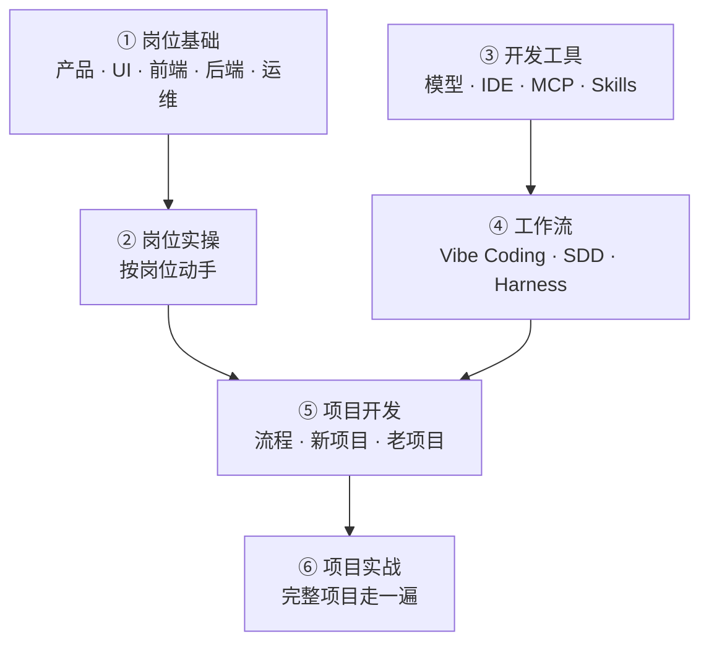

# AI 全栈开发指南

一本写给工程师的 AI 全栈实战书。不追热点，只回答一个问题：**怎么把 AI 能力做成能上线、能运维、成本算得清的系统。**


📌 **状态：草稿，持续更新。** 第一部分「岗位基础」五个岗位已经成体系，工具、工作流和项目部分正在补齐。🐙 源码与勘误：[haiqit/ai-fullstack-guide](https://github.com/haiqit/ai-fullstack-guide)


## 这本书想解决什么 🤔

大多数 AI 教程的终点，是「Demo 跑通了」。但一旦上线，等着你的是另一组问题：

* ⏱️ 一次请求要 8 秒，用户还愿意等吗？
* 💸 这个月账单翻了三倍，钱花在哪儿？
* 🌊 模型抽风、接口超时，服务会不会跟着雪崩？
* 📉 改了一版提示词，到底是变好了还是变坏了？

这本书用工程视角，把这些问题的答案整理成可以复用的方法和取舍。

## 全书结构 🗂️

<table data-view="cards"><thead><tr><th></th><th></th><th></th><th data-hidden data-card-target data-type="content-ref"></th></tr></thead><tbody><tr><td><h3>👥</h3></td><td><strong>第一部分 · 岗位基础</strong></td><td>产品、UI、前端、后端、运维：每个岗位真正在做哪些决策，这些决策又怎么变成技术的约束。</td><td><a href="di-yi-bu-fen-gang-wei-ji-chu/">di-yi-bu-fen-gang-wei-ji-chu</a></td></tr><tr><td><h3>🧪</h3></td><td><strong>第二部分 · 岗位实操</strong></td><td>按岗位动手：产品设计、UI 实战、前端开发、后端开发、运维部署。</td><td><a href="di-er-bu-fen-gang-wei-shi-cao/">di-er-bu-fen-gang-wei-shi-cao</a></td></tr><tr><td><h3>🧰</h3></td><td><strong>第三部分 · 开发工具</strong></td><td>模型、IDE、MCP、Skills：工具怎么选、怎么配、怎么接进日常开发。</td><td><a href="di-san-bu-fen-kai-fa-gong-ju/">di-san-bu-fen-kai-fa-gong-ju</a></td></tr><tr><td><h3>🔁</h3></td><td><strong>第四部分 · 工作流</strong></td><td>Vibe Coding、SDD、Harness：人和 AI 怎么分工，外加一份工具推荐。</td><td><a href="di-si-bu-fen-gong-zuo-liu/">di-si-bu-fen-gong-zuo-liu</a></td></tr><tr><td><h3>🚀</h3></td><td><strong>第五部分 · 项目开发</strong></td><td>开发流程，新项目怎么从零起，老项目怎么接手。</td><td><a href="di-wu-bu-fen-xiang-mu-kai-fa/">di-wu-bu-fen-xiang-mu-kai-fa</a></td></tr><tr><td><h3>🎯</h3></td><td><strong>第六部分 · 项目实战</strong></td><td>把前面所有东西串起来，完整项目从头到尾走一遍。</td><td><a href="di-liu-bu-fen-xiang-mu-shi-zhan.md">di-liu-bu-fen-xiang-mu-shi-zhan.md</a></td></tr></tbody></table>

一句话记住这六块：**先补岗位（① ②），再配工具（③ ④），最后落到项目（⑤ ⑥）。**


第一部分已经能当五本小册子读：产品、UI、前端、后端、运维。每本都是同一个路子：先破误解 → 知识模块 → 选型表 → 决策 → 技术后果映射表 → 通用坑 → 提问模板。如果你是后端，建议先从「产品」读起，再读「后端」「运维」——后两本正好接住你已有的工程直觉。


## 你该从哪读起 🛣️

同样的六部分，不同的人走法不一样。对号入座：

| 你现在的状态              | 建议路线                                                    |
| ------------------- | ------------------------------------------------------- |
| 🔄 **后端转 AI 全栈**    | ① 重点读「后端」「运维」 → ② 后端开发、运维部署 → ③ 模型、IDE → ④ 工作流 → ⑤ → ⑥  |
| 🎨 **前端 / UI 转 AI** | ① 读「前端」「UI」 → ② 前端开发、UI 实战 → ③ IDE、MCP → ④ 工作流 → ⑥ 项目实战 |
| 📋 **产品转 AI 全栈**    | ① 产品（整条读完） → ② 产品设计 → ④ 工作流 → ⑤ 开发流程 → ⑥                |
| 🎓 **从零入门**         | ① 五个岗位都过一遍 → ② 逐个动手 → ③ 配好工具 → ⑤ 跟流程 → ⑥ 做项目            |
| 🧑‍💼 **已经在带项目**    | ① 产品、运维 → ④ 工作流 → ⑤ 老项目 → ⑥                             |

你已有的工程直觉（超时、降级、观测、灰度、权限、数据模型）大部分能直接复用，需要新学的其实没那么多。


**只想先动手？** 直接去第五部分的「新项目」，照着流程做一个最小可上线的版本，卡住了再回来查对应章节。


## 这本书不写什么 🚧


**四条自我约束**

* 不写「三天速成」这种承诺
* 不写无法验证的性能数字；没实测过的地方明确标「待压测」
* 不把「理解原理」写成「亲手实践过」
* 不把某个框架说成唯一正确答案


## 许可 📄

* 书稿与文档：[CC BY-SA 4.0](https://github.com/haiqit/ai-fullstack-guide/blob/main/LICENSE-DOCS)
* 示例代码：[MIT](https://github.com/haiqit/ai-fullstack-guide/blob/main/LICENSE-CODE)
