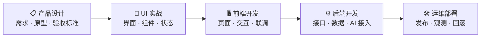

# 第二部分 · 岗位实操

岗位基础讲「知道」，这部分讲「动手」。每个岗位都要产出一样**可验收的东西**，而不是一句「做完了」。

## 本部分包含

<table data-view="cards"><thead><tr><th></th><th></th><th></th><th data-hidden data-card-target data-type="content-ref"></th></tr></thead><tbody><tr><td><h3>📋</h3></td><td><strong>产品设计</strong></td><td>从一个想法写出一份能进开发的需求：范围、流程、状态、异常态、验收标准。</td><td><a href="chan-pin-she-ji.md">chan-pin-she-ji.md</a></td></tr><tr><td><h3>🎨</h3></td><td><strong>UI 实战</strong></td><td>把需求变成界面：信息架构、组件、五种状态。</td><td><a href="ui-shi-zhan.md">ui-shi-zhan.md</a></td></tr><tr><td><h3>🖥️</h3></td><td><strong>前端开发</strong></td><td>页面、交互、数据流，以及和 AI 接口联调时的流式输出、超时与重试。</td><td><a href="qian-duan-kai-fa.md">qian-duan-kai-fa.md</a></td></tr><tr><td><h3>⚙️</h3></td><td><strong>后端开发</strong></td><td>接口设计、数据模型、AI 调用层封装，以及让服务扛住超时和并发。</td><td><a href="hou-duan-kai-fa.md">hou-duan-kai-fa.md</a></td></tr><tr><td><h3>🛠️</h3></td><td><strong>运维部署</strong></td><td>从本地跑通到线上可用：环境、发布、日志、指标、告警和成本。</td><td><a href="yun-wei-bu-shu.md">yun-wei-bu-shu.md</a></td></tr></tbody></table>

## 每个岗位的交付物 📦

| 岗位    | 交付物          | 怎么算做完                  |
| ----- | ------------ | ---------------------- |
| 产品设计  | 需求文档、原型、验收标准 | 评审能逐条过，异常态有定义          |
| UI 实战 | 设计稿、组件与状态规范  | 五种状态（正常/空/加载/错误/边界）都有稿 |
| 前端开发  | 可交互的页面       | 主流程和异常态都能走通            |
| 后端开发  | 接口契约、数据模型    | 契约测试通过，超时和失败有兜底        |
| 运维部署  | 可回滚的发布       | 有监控、有告警、回滚演练过          |

## 和第一部分怎么配合 🔗


第一部分回答「为什么要这样做」，这部分回答「具体怎么做」。动手卡住时，回第一部分查决策依据；评审有分歧时，用第一部分的表把问题问透。

