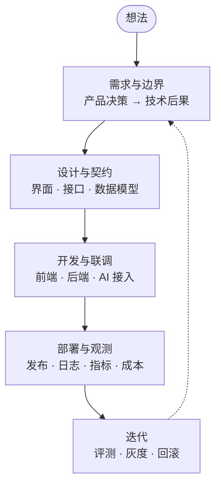

# 第六部分 · 项目实战

前面五部分讲的是「每个环节该怎么做」，这部分讲「**一条完整的路走下来是什么样**」。每一章都尽量给出可复用的产物：文档、表格、清单、代码片段。

## 这部分想做到什么 🎯


不是给你一个「照抄就能上线」的模板，而是给你一条**能拿去对照自己项目**的参考路径：每一步做了什么、产出什么、踩了哪些坑。


## 一个项目会经历什么 🗺️

## 建议用法 📌

1. 先读[开发流程](di-wu-bu-fen-xiang-mu-kai-fa/kai-fa-liu-cheng.md)，知道每一步该产出什么。
2. 对照自己是[新项目](di-wu-bu-fen-xiang-mu-kai-fa/xin-xiang-mu.md)还是[老项目](di-wu-bu-fen-xiang-mu-kai-fa/lao-xiang-mu.md)，选一条路。
3. 每走完一步，回到对应岗位的部分核对一遍：产品决策有没有漏定、异常态有没有定义、超时降级有没有兜底。

## 每一章的标准 📏

| 要有               | 不要有           |
| ---------------- | ------------- |
| 可复用的产物（文档、清单、片段） | 「照着做就行」的绝对化结论 |
| 明确的取舍和代价         | 无法验证的性能数字     |
| 踩过的坑和怎么绕过去       | 只展示成功路径       |


这部分正在逐步补齐。已发布的内容会明确标注「已完成 / 进行中」，没写完的不会拿半成品凑数。

