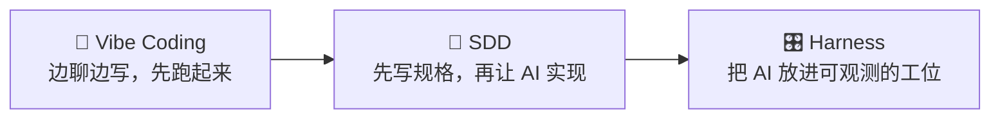

# 第四部分 · 工作流

工具再好，也得有人和方法把它用起来。这部分讲的是：**人和 AI 到底怎么分工，什么活该让 AI 干、什么活必须自己把关。**

## 本部分包含

<table data-view="cards"><thead><tr><th></th><th></th><th></th><th data-hidden data-card-target data-type="content-ref"></th></tr></thead><tbody><tr><td><h3>💬</h3></td><td><strong>Vibe Coding</strong></td><td>快速探索、小工具、原型：适合不确定性高的阶段，不适合核心业务。</td><td><a href="vibe-coding.md">vibe-coding.md</a></td></tr><tr><td><h3>📝</h3></td><td><strong>SDD</strong></td><td>规格驱动开发：先把契约和验收标准写清楚，再让 AI 实现，可评审、可追溯。</td><td><a href="sdd.md">sdd.md</a></td></tr><tr><td><h3>🎛️</h3></td><td><strong>Harness</strong></td><td>围绕 AI 的工作台：上下文、工具、测试、审查、回滚，一样都不能少。</td><td><a href="harness.md">harness.md</a></td></tr><tr><td><h3>⭐</h3></td><td><strong>推荐</strong></td><td>按场景推荐工具组合，避免「什么都装一遍」。</td><td><a href="tui-jian.md">tui-jian.md</a></td></tr></tbody></table>

## 选哪种工作流 🤔

| 场景            | 先用          | 为什么            |
| ------------- | ----------- | -------------- |
| 不确定要做什么、先验证想法 | Vibe Coding | 快，错了扔掉也不心疼     |
| 需求清楚、要长期维护    | SDD         | 规格就是契约，改起来有据可依 |
| 已经上线、要持续迭代    | Harness     | 重点是可控、可观测、可回滚  |


不管用哪种，底线是一样的：**AI 写的代码，你能说清楚它做了什么、怎么验证、怎么回滚。** 说不清，就不是「用得好」，只是「用得爽」。

