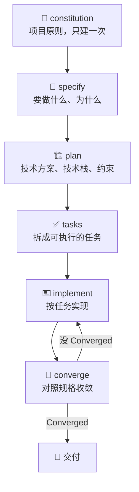

# SpecKit

GitHub 官方出的 SDD 工具包。三个里它最「重」：有宪法、有阶段、有一整套模板、脚本和扩展机制。你要的不是灵活，是**可重复**——同一套流程，换个人、换个项目，跑出来还是一个样。

它现在不只做功能开发了。1.0 之后拆成三个独立入口：写功能、修 bug、评估一个想法值不值得做。三个入口互不依赖，不需要先走一遍 SDD 才能修 bug。

## 核心是「宪法 + 一条主线」📜

每个项目先立一份 constitution，把不可谈判的原则写死：代码质量、测试要求、可维护性边界。之后每个功能都沿着同一条线往下走：



有两个地方跟另外两个工具不一样：

* **constitution 是项目级的。** 不是每个需求写一遍，是整个项目一份。它的作用是让后面所有的 plan 和 tasks 都有个统一的裁判。
* **有 converge 阶段。** implement 完不算完，要再跑一次收敛，确认实现和规格对得上。没对上就回去改，直到它报 `Converged`。

## 装它 🧰

需要 Python 3.11+ 和 uv：

```bash
uv tool install specify-cli
specify init my-project --integration claude
cd my-project
```

`--integration` 后面接你的工具。Claude Code 用 `claude`，Copilot 用 `copilot`，Cursor、Gemini 这些也都有对应的 key。已有的项目也能接，不用新建目录。

装完在项目里启动 coding agent，命令都在对话里敲，不在终端敲。**一步一步来，每一步的结果看过了再走下一条**——这是它和「一句话让 AI 全做完」最根本的区别。

## 三个入口 🚪

| 你要干的事       | 怎么进                            | 产物                                  |
| ----------- | ------------------------------ | ----------------------------------- |
| 做一个功能或应用    | 直接走 SDD                        | 规格 → 计划 → 任务 → 实现 → 收敛              |
| 查一个 bug 并修掉 | `specify extension add bug`    | 原因评估、限定范围的修复、验证记录                   |
| 判断一个想法值不值得投 | `specify extension add assess` | go / needs-clarification / kill 的结论 |

修 bug 那条线是这样：

```
/speckit-bug-assess "提交空密码会让登录表单崩溃" slug=login-crash
/speckit-bug-fix slug=login-crash
/speckit-bug-test slug=login-crash
```

报告落在 `.specify/bugs/login-crash/`。最后会给你一个结论：`verified`、`partial` 还是 `failed`。**只有 verified 才算真修好了**，partial 意思是症状没了但根因还在。

评估那条线更适合产品早期：

```
/speckit-assess-intake "让用户离线工作，联网后同步" slug=offline-mode
/speckit-assess-research slug=offline-mode
/speckit-assess-define slug=offline-mode
/speckit-assess-shape slug=offline-mode
/speckit-assess-decide slug=offline-mode
```

结论是 `go`、`needs-clarification` 或 `kill`。有意思的是它把「有理由地不做」也当成一个正常结果——很多评估工具只教你怎么立项，不教你怎么砍需求。

## SDD 主线长什么样 📋

一个功能跑完，大概敲这些：

```
/speckit-constitution 代码质量、测试、可维护性优先。
/speckit-specify 做一个相册应用，按日期分组，每个相册有缩略图预览。
/speckit-plan 用 Vite + 原生 JS，图片存本地，元数据放 SQLite。
/speckit-tasks
/speckit-implement
/speckit-converge
```

命令的写法各工具不同：有的用短横线 `/speckit-constitution`，有的用点号 `/speckit.constitution`，还有的带前缀。别猜，`specify init` 结束时会打印你这个工具该用哪种。

产物基本都在两处：`.specify/` 放模板、脚本和记忆文件，`specs/` 放每个功能自己的规格、计划和任务。好处是全部是纯文本，能进 Git，能 code review，也能在 CI 里做检查。

## 代价 ⚖️

| 你得到的                | 你要付的                  |
| ------------------- | --------------------- |
| 流程可重复，新人照着走也不会太偏    | 文档量是所有工具里最大的          |
| 宪法 + 阶段门，关键决策不容易被跳过 | 小需求也被拖进完整流程           |
| 扩展、预设、工作流都能定制       | 定制本身要学习成本             |
| 规格、计划、任务全部可追溯       | 要 Python 和 uv，环境多一层依赖 |

它的定位很清楚：**给需要审计、需要多人协作、需要「换个 AI 也能接着干」的项目用的。** 一个人写个小工具，用它是杀鸡用牛刀。

## 几个我踩过的坑 🕳️

* **constitution 当摆设。** 建完就再也没打开过，后面 plan 里该有的约束一条没有。宪法要么写短写实，要么别建。
* **specify 阶段敷衍。** 这一步没把边界和验收标准写清楚，后面 tasks 一定拆得乱七八糟。阶段门不是形式，是让你在这儿停下来想。
* **spec 里只有功能描述，没有验收条件。** 结果 AI 实现得挺像样，但没法判断算不算完成。每个需求后面补一句「怎么算做完」。
* **扩展装太多。** bug、assess、再加几个社区扩展，命令面板能翻半天。先装一个，用顺了再加。
* **implement 完就收工。** converge 没跑到 `Converged` 就走人，等于前面几步白做。它报没收敛，大概率是规格里有几条没覆盖到。
* **拿点号命令去短横线的工具里敲。** 不报错，只是没反应，然后你以为工具坏了。

## 什么时候别用 🚫

* 一个人维护的小项目，需求一周变三次。
* 改个样式、修个 typo、加个日志。
* 团队里没人愿意维护那套 Markdown。Spec Kit 的价值一半在文档被真的读，没人读就只剩流程成本。


如果你的项目已经跑了很久，先看 [OpenSpec](https://haiqit.gitbook.io/ai-fullstack-guide/di-si-bu-fen-gong-zuo-liu/harness/openspec)——它对存量代码更友好，改动也更轻。Spec Kit 更适合从零起或者流程要重立的场景。


## 一句话

**Spec Kit 把「写清楚再动手」制度化到有点官僚的程度——项目越大、人越多，这份官僚越值钱。**
