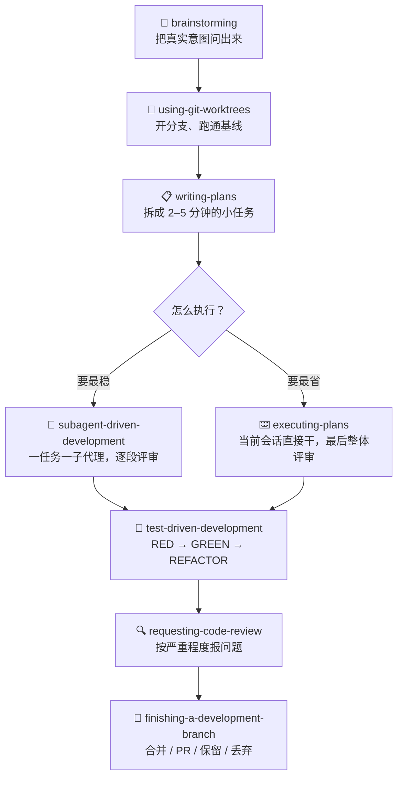

# Superpowers

Harness 这一节聊的是「怎么给模型立规矩」。Superpowers 是我见过把这件事做得最彻底的一个：它不指望你记得在什么时候喊什么命令，而是让 agent 一开工就先把规矩背出来。

作者是 Jesse Vincent，社区里管它叫「给 coding agent 装了一套完整的开发方法论」。这个说法不算夸张——它由一堆可组合的 skill 加一段启动指令组成，核心承诺只有一句：**在写第一行代码之前，先把要做什么问清楚。**

## 一条需求会经历什么 🔁

装好之后，你只要说「我想做个 X」，接下来大概是这样：



几个细节值得说：

* **brainstorming 会先唱反调。** 它不顺着你的方案往下写，而是追问「你真正想解决的是什么」。小改动在对话里对齐，大项目会产出一份设计文档，短到你能一口气读完。
* **计划细到有点变态。** 每个任务 2–5 分钟，写清楚改哪个文件、代码长什么样、怎么验证。README 的原话是：细到「一个热情但没品位、没判断力、不了解项目、还讨厌测试的初级工程师」也能照着做。
* **TDD 是硬约束。** 先写失败的测试，看着它失败，再写最小实现让它通过。先写代码后补测试的，代码会被删掉重来。
* **执行分两个档位。** `subagent-driven-development` 每个任务派一个干净的子代理，做完就评审，最稳也最贵；`executing-plans` 在当前会话里一路做下去，最后统一评审一次，便宜但上下文容易糊。

## 装它 🧰

Claude Code 最省事，官方市场里就有：

```bash
/plugin install superpowers@claude-plugins-official
```

想跟着作者自己的市场更新，也可以这样：

```bash
/plugin marketplace add obra/superpowers-marketplace
/plugin install superpowers@superpowers-marketplace
```

Codex、Cursor、Gemini CLI、Copilot CLI、OpenCode 这些都有自己的装法，仓库 README 里列了十几个 harness，照着抄就行。**每个 harness 要单独装**，装了 Claude Code 不会顺带把 Cursor 也配上。

装完不用记命令。它靠 `using-superpowers` 这段启动指令在会话开始时把自己接上，之后按任务自动触发。

## 里面有什么 📦

Skills 按用途分成三类，常用的就这些：

| 类别  | Skill                            | 干什么                |
| --- | -------------------------------- | ------------------ |
| 协作  | `brainstorming`                  | 动手前把意图问出来          |
| 协作  | `writing-plans`                  | 拆细到可执行的实施计划        |
| 协作  | `executing-plans`                | 单会话顺序执行 + 最终评审     |
| 协作  | `subagent-driven-development`    | 子代理逐任务执行 + 两段式评审   |
| 协作  | `dispatching-parallel-agents`    | 并行跑多个子代理           |
| 协作  | `using-git-worktrees`            | 用 worktree 隔离开发环境  |
| 协作  | `requesting-code-review`         | 提交前的自检清单           |
| 协作  | `receiving-code-review`          | 怎么消化评审意见           |
| 协作  | `finishing-a-development-branch` | 收尾：合并、开 PR、还是丢掉    |
| 测试  | `test-driven-development`        | RED-GREEN-REFACTOR |
| 调试  | `systematic-debugging`           | 四阶段找根因             |
| 调试  | `verification-before-completion` | 别急着说「修好了」          |
| 调试  | `diagnosing-superpowers`         | 排查这套 skill 自己出的问题  |
| 元技能 | `writing-skills`                 | 按它的规范写新 skill      |

还有一条很好用的自救路径：某个会话行为不对——skill 该触发没触发、agent 不按计划走、token 烧得离谱——直接说「figure out what went wrong with superpowers in this session」，它会去读会话记录，按行给你证据，需要的话还能打成一个脱敏的包给你提 issue。

## 代价也很明确 ⚖️

| 你得到的              | 你要付的             |
| ----------------- | ---------------- |
| 需求、计划、测试、评审全都有据可查 | token 消耗明显高于裸跑   |
| 子代理隔离上下文，长任务不容易跑偏 | 一个任务要起好几次会话，慢    |
| TDD 和评审是强制的，不靠自觉  | 小改动也会被拉进流程       |
| 出问题能复盘到具体某一行      | 学习成本在「理解它为什么这么干」 |

我自己的感受很直接：**它适合「这件事值得做对」，不适合「这件事赶紧做完」。**

## 几个我踩过的坑 🕳️

* **拿它改文案。** brainstorming 会认真地跟你讨论文案背后的用户意图，聊十分钟，改一行字。后来我学会了一句话需求直接自己动手。
* **worktree 用完不清理。** 每个分支一个 worktree，攒上十几个之后，磁盘和 `git branch` 都会变得很难看。收尾时走 `finishing-a-development-branch`，它会问你要不要清。
* **把子代理的评审当摆设。** 它报 critical 的时候一定要停下来看。有些问题在你眼里「不严重」，等合进去就不是这个价了。
* **跟项目自己的 `CLAUDE.md` 抢方向盘。** 两边都写了流程，agent 会挑着执行。要么以 Superpowers 为主，要么把项目规则收进它的计划里，别让两套规矩并行。

## 什么时候别用 🚫

* 一行改动、改个配置、修个 typo。
* 探索性的一次性脚本，跑完就删。
* 你已经很清楚要什么，而且改动范围就在一个文件里。


判断标准跟 [推荐](https://haiqit.gitbook.io/ai-fullstack-guide/di-si-bu-fen-gong-zuo-liu/tui-jian) 那页说的一样：**一个会话能不能干完。** 能干完的，走这套流程纯属给自己加戏。


## 一句话

**Superpowers 把「专业工程师的工作习惯」写成了 agent 必须遵守的流程——代价是你得接受它真的会按流程走。**
