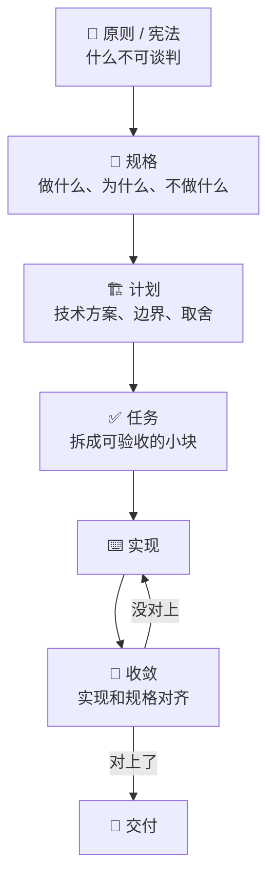

# SDD

SDD，Spec-Driven Development，规格驱动开发。一句话：**先把「要什么」写成规格，规格是主产物，代码是规格的实现。**

这概念本身不新，需求工程、瀑布模型里都有它的影子。它重新火起来，是因为 AI 改变了一件事的成本结构：写规格依然要花时间，但**按规格实现**几乎不花时间了。当实现变便宜，瓶颈自然就挪到了「说清楚」这一步。

## 为什么现在又值得聊 📈

以前大家不写详细规格，不是不知道它好，是算不过账：写一周规格，实现两周，规格占总成本三分之一，需求一变全白写。

现在反过来了。实现可能只要半天，规格还是那一周——于是规格成了最贵的东西，也成了最该做对的东西。更现实的原因是：

* **聊天记录不是资产。** 需求只活在上下文里，会话一关就没了。下次换个人、换个模型，一切从头讲。
* **模型会自信地补全空白。** 你没说清楚的地方，它不会停下来问，而是编一个看起来合理的答案，然后一路错下去。
* **多会话、多 agent 需要共同的事实来源。** 上下文会压缩、会丢，文件不会。
* **要能审计。** 「为什么当时这么做」得有地方查。

## 一条标准的主线 🔁

每一步都有个产出物，而且这个产出物要能被下一个人（或下一个会话）直接接住。**SDD 的核心不是流程步骤，是这些文件。**

这里有个容易走偏的地方：很多人把 SDD 理解成「写一份很长的需求文档」。不是。规格的价值在于**可验证**——每一条需求后面都得跟一句「怎么算做到了」。没有验收标准的规格，只是散文。

## 它和 TDD、DDD 是什么关系 🧩

三个词经常被混着用，其实管的是不同的事：

|     | 管什么         | 先写什么 |
| --- | ----------- | ---- |
| SDD | 做什么、为什么做    | 规格   |
| TDD | 怎么证明做到了     | 测试   |
| DDD | 用什么样的语言描述问题 | 领域模型 |

它们可以叠。SDD 把需求写成带场景的规格，TDD 把场景变成测试，DDD 保证你和 AI 说的是同一套词。**SDD 管方向，TDD 管证据，DDD 管语言。**


判断一份规格够不够硬，看它能不能直接翻译成测试用例。翻不出来的部分，多半还是模糊的。


## 市面上几个流派 🧰

| 工具                                                                                                  | 风格                     | 适合谁          |
| --------------------------------------------------------------------------------------------------- | ---------------------- | ------------ |
| [Spec Kit](https://haiqit.gitbook.io/ai-fullstack-guide/di-si-bu-fen-gong-zuo-liu/harness/spec-kit) | 重，宪法 + 阶段门 + 扩展机制      | 新项目、多人协作、要审计 |
| [OpenSpec](https://haiqit.gitbook.io/ai-fullstack-guide/di-si-bu-fen-gong-zuo-liu/harness/openspec) | 轻，每个改动一个目录，随时可改        | 存量项目、需求变化快   |
| Kiro                                                                                                | IDE 内置，绑定 AWS 和 Claude | 愿意换 IDE 的团队  |
| 一页 spec                                                                                             | 不装工具，仓库里放一份 Markdown   | 一个人、中小需求     |

还有更轻的：Mattpocock 那套里的 `/to-spec` 和 `/to-tickets`，本质上就是 SDD 的最小实现——先写一页，再拆成票。不想上工具的话，从这儿开始就行，具体看 [推荐](https://haiqit.gitbook.io/ai-fullstack-guide/di-si-bu-fen-gong-zuo-liu/tui-jian) 那页。

## 反模式 ⚠️

SDD 失败的样子高度一致，基本就这几种：

* **规格剧场。** 文档写得又厚又漂亮，没人读，AI 也不读。写了等于没写，还多花了时间。
* **规格漂移。** 代码改了，规格没改。三个月后规格成了历史小说，新人照着它理解系统，全错。
* **过度前置。** 改个按钮也要走完 specify → plan → tasks。流程成本超过改动本身。
* **把规格当合同。** 需求本来就会变，规格必须能改。改一次要走三天审批的规格，最后一定没人维护。
* **只写 happy path。** 异常态、边界、并发、权限全没写。AI 会把这些地方留空，或者按最乐观的方式实现。

## 什么时候值得 📌

* 一次改动跨多个模块、多个仓库。
* 有第二个人（或者第二个会话）要接着做。
* 需要向外部解释、审计、合规。
* 需求会被反复引用，不是一次性问一句就完。
* 任务大到要拆成好几张票。

## 什么时候别用 🚫

* 探索性原型，方向都还没定。
* 一行改动、修个 typo。
* 需求本身还在剧烈变化，写了也是白写。
* 团队里没人愿意维护那份规格。

## 我的用法 🧭

我现在基本是三档：



### 小改动

不写 spec，直接 `/implement`。



### 中等任务

用 `/grill-with-docs` 把需求问透，然后在仓库里写一页 spec——不超过一屏，写清目标、不做什么、验收标准。



### 大任务

才上 Spec Kit 或 OpenSpec。工具的价值在于帮你管住多轮、多会话、多人。



还有一条铁律：**spec 放进仓库，跟代码一起 review。** 改代码不改 spec，比没有 spec 更危险——因为下一个人会相信它。

## 一句话

**SDD 不是让你写更多文档，是让你在动手前把「完成」定义清楚。**
