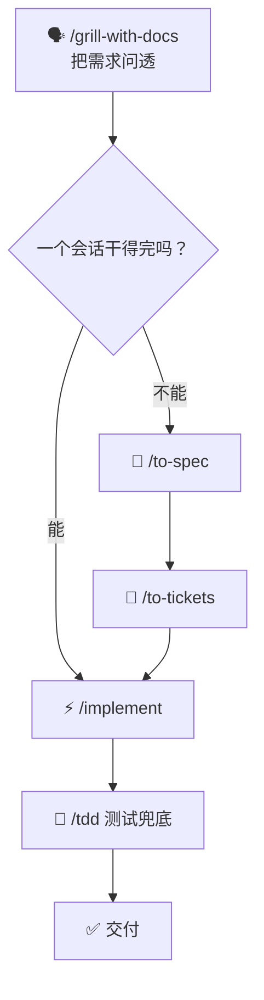

# MattPocock skills

前面几页聊的都是「怎么干活」：Vibe Coding 跟着感觉走，SDD 先把规格写死，Harness 用护栏把模型圈住。这些解决的是方向问题。真坐到工位上，你手上还得有一套现成的家伙事儿。

这一页只推一套：**Mattpocock 的 skills**。

> Skills for Real Engineers. Straight from my .agents directory.
>
> 给真工程师用的技能，直接抄自我日常在用的目录。

仓库在 `github.com/mattpocock/skills`。

## 我是怎么从「流程控」变成「卸护栏」的 🙃

GPT-5.4 和 Opus 4.6 那会儿，模型第一次能在给足上下文的前提下把活干得像样，Harness Engineering 这个词也跟着火。我当时的反应很典型：Superpowers、OpenSpec、Spec-Kit 全装，SDD 加 TDD，不管需求大小都按流程走一遍。

头几个复杂需求确实香。流程替我盯着，漏的东西少，返工也少。但很快就发现账不对：

* 一个不大的改动，光走流程就烧掉一大截 token；
* 更别扭的是，上下文明明已经够它直接开写了，它还在那儿一步一步把流程演完，像在陪跑。

转折点是模型升级。新模型不太需要那么多护栏了，原先觉得「稳」的约束，反而成了拖它后腿的绳子。后来 OpenAI 发 Astra 的时候专门写了篇博客，讲怎么清理多余的 Skill 和系统提示词——官方都出来说这事了，意思很明白：**约束不是越多越好**。

这套 skills 让我留下的原因也在这儿：它不塞给你一堆流程，而是给你几个卡在关键位置的扳手。

## 装它 🧰



```bash
claude plugin install mattpocock-skills@claude-plugins-official
```



```bash
codex plugin marketplace add mattpocock/skills
codex plugin add mattpocock-skills@mattpocock
```



装完先别急着用，跑一次 `/setup-matt-pocock-skills`。这一步会把这套东西接到你当前的项目结构上，跳过它基本等于装了个摆设。

## 它治的是四个老毛病 🩺


这些问题跟模型聪不聪明关系不大。卡住的地方多半在「你和它之间」——没有共同的规矩、没有共享的词、没有能验证的反馈、没有守住结构的边界。

### 毛病一：AI 做的不是你要的

> 没人确切知道自己想要什么。
>
> ——《程序员修炼之道》

你觉得需求讲清楚了，AI 答得也快，交付出来对不上。复盘时才发现，问题出在需求压根没被问透。人不会主动暴露自己没想清楚的地方，AI 也不会替你追问。

**解药：让它反过来盘问你。** `/grill-me` 把提问权交给 AI，一个问题一个问题往下挖；`/grill-with-docs` 更进一步，边问边翻项目里的文档和约定。

### 毛病二：AI 太啰嗦

> 有了统一语言，开发者之间的对话和代码表达都源自同一个领域模型。
>
> ——《领域驱动设计》

项目里有个概念叫「订单物料化流程」，每次跟 AI 解释都得说一长串。它不懂你的行话，只能用二十个词说一个词的事——token 是这么没的，沟通成本也是这么堆起来的。

**解药：共享语言。** 用一个 `GLOSSARY.md` 建项目词汇表，`/grill-with-docs` 会自动往里读，`/domain-modeling` 负责长期维护。词表立起来之后，一句话能顶过去一段话。

### 毛病三：代码跑不起来

> 永远小步前进。反馈的速率就是你的限速。
>
> ——《程序员修炼之道》

AI 说「搞定了」，你一跑，报错。修完这个又冒新的。没有测试、没有类型检查，整个过程就是个黑箱，你只能靠「再试一次」碰运气。

**解药：反馈回路。** `/tdd` 先写测试再写实现（新的 `/implement` 默认会调它），`/diagnosing-bugs` 负责把排错变成有章法的排查，而不是来回瞎改。

### 毛病四：项目变成一坨泥球

> 每天都要投资于系统的设计。
>
> ——《极限编程解析》
>
> 最好的模块是深的：大量功能通过简单接口暴露。
>
> ——《软件设计哲学》

AI 写得快，代码变乱也快。它加速了软件的熵增——复杂度膨胀的速度，比你以前手写时快得多。

**解药：守住结构。** `/to-spec` 动手前先问清楚要碰哪些模块；`/improve-codebase-architecture` 隔几天扫一次「深化机会」，趁乱之前先收拾。

## 实际跑起来是什么样 🔁


主干只有一条：先拷问，再分流，最后落地。



## `/grill-with-docs` 拷问需求

别跳过。问题问得越具体，后面返工越少。



## 按体量分流

一个会话能干完的，直接 `/implement`；干不完的，先 `/to-spec`，再 `/to-tickets`。



## `/implement` 落地

大任务走到这一步，手上应该是一张张能单独验收的票。



| 任务体量       | 走法                                        | 理由                  |
| ---------- | ----------------------------------------- | ------------------- |
| 一个会话能干完    | 直接 `/implement`                           | 再拆就是给自己加戏           |
| 跨模块、要动数据结构 | `/to-spec` → `/to-tickets` → `/implement` | 先把边界想清楚，再切成能独立验收的小块 |
| 需求本身还没想明白  | 回到 `/grill-with-docs`                     | 别带着模糊进实现            |



大任务那条路上，`/to-tickets` 出来的每一张票都应该能单独验收。切不动的票，说明 spec 还没写透，回去补，别硬拆。

## 几个我踩过的坑 🕳️

* **小改动也走全流程。** 改个文案、补个日志，流程本身比代码还贵。判断标准很简单：一个会话能不能干完，能就别拆。
* **`GLOSSARY.md` 建了不维护。** 词汇表一旦和代码里的叫法脱节，它就从「共享语言」变成「误导来源」。隔一阵得回头对一遍。
* **`/to-spec` 写成 PRD。** 越写越厚，最后没人看。spec 是给下一步拆票和实现用的，够用就行。
* **skills 和自己的 `CLAUDE.md` 打架。** 规矩叠两层，模型会挑着遵守。留一套主心骨，其余的能删就删。
* **装完不跑 `/setup`。** 前面提过了，还是有人踩。技能装上了但没接上项目，行为跟没有差不多。


这套东西的价值在「关键节点上多问一句」，不在「每一步都走一遍」。哪天你觉得流程在拖后腿，直接砍掉，别供着。


## 什么时候别用 🚫

* 一次性脚本、临时验证想法：直接说，别拷问。
* 线上故障抢修：先止血，事后补测试和复盘。
* 需求已经清楚到能写成三行：`/implement` 就够。

## 一句话

**流程负责在关键节点替你踩刹车，不负责陪你走完全程。**

想再往上走一层，可以接着看 [Harness](https://app.gitbook.com/s/qq1tVrg4Zxu0vgNP9F2B/di-si-bu-fen-gong-zuo-liu/harness)——护栏怎么设计，以及什么时候该拆。
