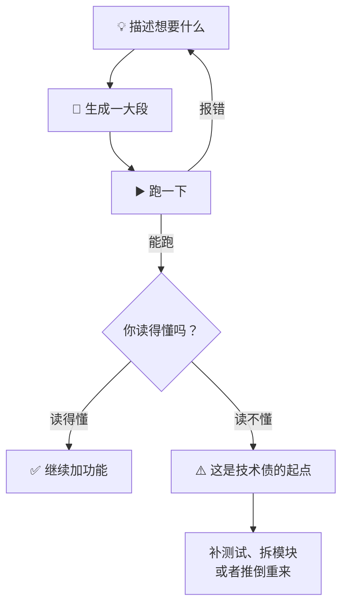

# Vibe Coding

2025 年初，Karpathy 发了条推，说有一种新的写代码方式，叫 vibe coding：完全交给感觉，拥抱指数增长，忘了代码这回事。

半年后这个词传遍全网，也彻底变了味。有人拿它当「AI 写代码」的代名词，有人拿它当不做测试的借口。其实它原本的适用范围窄得很——**扔掉也不心疼的项目**。

## 它到底是什么 🎛️

原文很短，值得完整读一遍：

> There's a new kind of coding I call "vibe coding", where you fully give in to the vibes, embrace exponentials, and forget that the code even exists.

翻成中文：你不再逐行读代码，不再纠结实现细节，只负责描述想要什么、看结果对不对，然后接着描述下一个想法。

关键在最后半句——**忘了代码的存在**。这不是修辞。它意味着你放弃了三样东西：对实现的理解、对边界的掌控、以及对「为什么能跑」的解释权。对周末项目，这笔交易很划算；对生产系统，这是拿命换速度。

## 它为什么爽 ⚡

* **从想法到能跑，中间没有仪式。** 不用建分支、不用写计划、不用评审，说完就有一个能点的页面。
* **特别适合视觉类的东西。** UI、动效、数据可视化，你看着不对就让它改，比画原型快得多。
* **它把「开始」的成本降到了接近零。** 很多想法死在「算了不弄了」，vibe coding 让它至少能活到一个能 demo 的状态。

我自己的用法是：脑子里冒出个东西，先花半小时 vibe 一个能跑的最小版本出来。**能跑之后，再决定要不要认真做。** 很多想法在这一步就被淘汰了，省下的时间比省下的代码值钱。

## 边界在哪儿 🚧

真正的问题不是「AI 写得对不对」，而是**你失去了判断它对不对的能力**。一旦代码超出你的阅读速度，后面每一次修改都变成赌博：

* **反馈靠猜。** 没测试、没类型，报错只能靠「再试一次」。
* **上下文会烂。** 对话拉到几百轮，模型早忘了你第三轮定下的约定，还在自信地往下写。
* **不可维护。** 两周后回来，你面对的是一个自己没写过、也读不懂的代码库。
* **安全边界消失。** 权限、鉴权、数据校验这些地方，vibe 出来的代码通常只有 happy path。

| 适合 vibe      | 不适合 vibe   |
| ------------ | ---------- |
| 周末项目、demo、原型 | 支付、权限、数据迁移 |
| 一次性脚本、数据清洗   | 需要长期维护的服务  |
| UI / 视觉探索    | 多人协作的代码库   |
| 「先看看这东西长什么样」 | 「下周上线」     |

## 想用久一点，至少加三道护栏 🛡️

Vibe coding 不是不能用，是不能裸用。我后来给自己定了三条最低限度的规矩：



### 每个能跑的状态都 commit 一次

这是唯一能让你大胆试错的保险。没有 Git，vibe coding 就是单向门。



### 给它一个能自己验证的入口

一个测试、一个 `curl`、一个截图对比都行。模型能自己跑、自己看结果，比你来回贴报错快一个数量级。



### 一次只改一件事

一口气生成两千行，出问题时你连从哪儿查都不知道。小步改、小步验，出错也好回滚。



再往上走一层，就是 Simon Willison 说的 **vibe engineering**：同样是让 AI 写大部分代码，但工程师保留规格、测试、评审和架构判断。区别不在用不用 AI，在于**谁对结果负责**。


Vibe coding 和后面几页不是对立关系。它是最短路径，SDD 和 Harness 是另外两条路。**先想清楚这次要的是「快」还是「稳」，再选路。**


## 几个我踩过的坑 🕳️

* **不 commit 就开始大改。** 改崩了想回到上一版，发现上一版也没存。现在我的习惯是：能跑就先 commit，哪怕提交信息写「能跑」。
* **在一个会话里聊到天荒地老。** 模型开始重复、开始忘事、开始改坏已经好的地方。判断信号很明显：它开始「重新实现」你已经确认过的东西。这时候新开会话，把约定写成文件带过去。
* **拿它修线上 bug。** 看着像修好了，其实只是把异常吞了。线上问题还是要走排查流程，别用感觉对赌。
* **生成完不看依赖。** 引进来一堆不认识的包，版本还互相冲突。生成完先看一眼 `package.json` 或 `requirements.txt` 变了什么。
* **把「能跑」当成「做完了」。** 能跑只是起点。要不要测试、要不要拆模块、要不要写文档，是另一个问题，别让 vibe 的惯性替你回答。

## 什么时候别用 🚫

* 这段代码两周后还会有人改。
* 出错会赔钱、会泄露数据、会被人利用。
* 你需要向别人解释它为什么是对的。

## 一句话

**Vibe coding 是「把想法变成能跑的东西」的最短路径，不是「把东西变成能长期维护的系统」的路径。**
