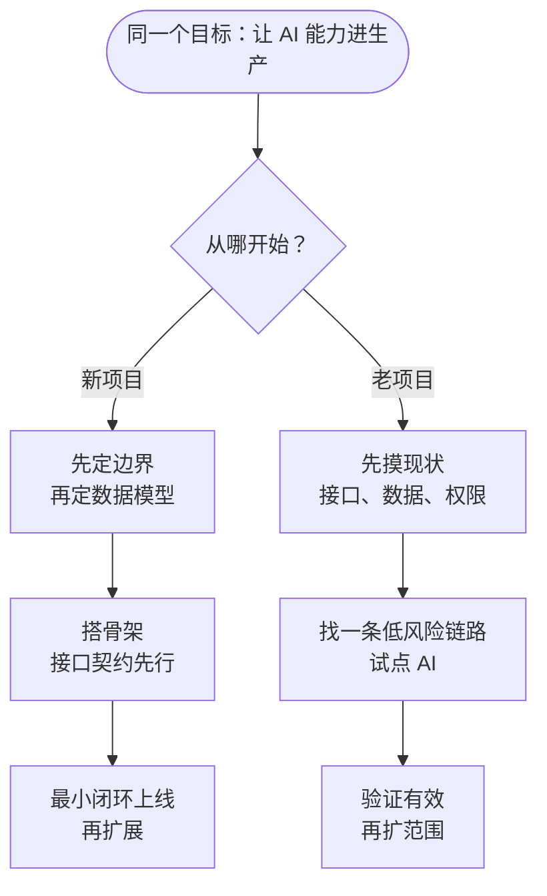

# 第五部分 · 项目开发

前面都是「零件」，这部分讲怎么把零件装成一台能跑的车。同一个流程，新项目和老项目走的顺序正好相反。

## 本部分包含

<table data-view="cards"><thead><tr><th></th><th></th><th></th><th data-hidden data-card-target data-type="content-ref"></th></tr></thead><tbody><tr><td><h3>🧭</h3></td><td><strong>开发流程</strong></td><td>从需求到上线的通用流程：每一步产出什么、谁来验收、什么时候能进下一步。</td><td><a href="kai-fa-liu-cheng.md">kai-fa-liu-cheng.md</a></td></tr><tr><td><h3>🌱</h3></td><td><strong>新项目</strong></td><td>从零开始：先定边界和数据模型，再写代码，避免一开始就埋不可逆的坑。</td><td><a href="xin-xiang-mu.md">xin-xiang-mu.md</a></td></tr><tr><td><h3>🏚️</h3></td><td><strong>老项目</strong></td><td>接手已有系统：先摸清现状和风险，再小步引入 AI 能力，别一上来就重构。</td><td><a href="lao-xiang-mu.md">lao-xiang-mu.md</a></td></tr></tbody></table>

## 新项目 vs 老项目 🔀

| 对比项       | 新项目       | 老项目        |
| --------- | --------- | ---------- |
| 最先做的事     | 定边界、定数据模型 | 摸现状、定风险清单  |
| 最大风险      | 不可逆决策定错   | 推到重来、破坏存量  |
| 引入 AI 的方式 | 从设计开始考虑   | 选一条链路试点    |
| 成功标准      | 最小闭环能上线   | 存量不受影响且有收益 |


老项目最忌讳的一句话是「趁这次接 AI，把架构一起重构了」。两件事分开放：先证明 AI 能带来价值，再谈重构。

