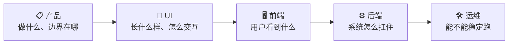

# 第一部分 · 岗位基础

AI 全栈不是「一个人把五个岗位的活全干了」，而是**知道每个岗位在决定什么，以及那个决定会变成谁的约束**。

一个需求从想法走到上线，会依次经过五个岗位的手：

## 本部分包含

<table data-view="cards"><thead><tr><th></th><th></th><th></th><th data-hidden data-card-target data-type="content-ref"></th></tr></thead><tbody><tr><td><h3>📋</h3></td><td><strong>产品</strong></td><td>需求优先级、用户故事与验收、状态机、B/C 端差异、商业化与合规。内容最完整，六个子页可以单独读。</td><td><a href="chan-pin/">chan-pin</a></td></tr><tr><td><h3>🎨</h3></td><td><strong>UI</strong></td><td>信息怎么分层、状态怎么表达，以及设计决策会变成多少前端实现成本。</td><td><a href="ui.md">ui.md</a></td></tr><tr><td><h3>🖥️</h3></td><td><strong>前端</strong></td><td>交互、数据流、错误与空态；AI 应用还多出流式输出、超时重试这些新问题。</td><td><a href="qian-duan.md">qian-duan.md</a></td></tr><tr><td><h3>⚙️</h3></td><td><strong>后端</strong></td><td>接口契约、数据模型、超时与降级、权限与多租户——AI 能力最后都落到这些工程问题上。</td><td><a href="hou-duan.md">hou-duan.md</a></td></tr><tr><td><h3>🛠️</h3></td><td><strong>运维</strong></td><td>部署、观测、成本、灰度；模型服务的运维和传统服务哪里不一样。</td><td><a href="yun-wei.md">yun-wei.md</a></td></tr></tbody></table>

## 「产品」这条线已经能单独读 📖

如果你是后端转全栈，建议先把产品这条线读完——它讲的每个决策，最后都会变成你的表结构、接口和状态机：

* [先破一个误解：产品岗不是「画原型、写文档」](chan-pin/chan-pin-gang-bu-shi-hua-yuan-xing-xie-wen-dang.md)
* [产品岗的知识内核：六个模块](chan-pin/chan-pin-gang-de-liu-ge-zhi-shi-mo-kuai.md)
* [选型维度表：每个业务方案背后的技术账](chan-pin/xuan-xing-wei-du-biao-mei-ge-fang-an-bei-hou-de-ji-shu-zhang.md)
* [产品决策 → 技术后果：一张能当 checklist 用的映射表](chan-pin/chan-pin-jue-ce-ji-shu-hou-guo-yi-zhang-checklist.md)
* [产品岗的通用坑](chan-pin/chan-pin-gang-de-qi-ge-tong-yong-keng.md)
* [提问模板：把问题问透](chan-pin/ti-wen-mu-ban-ba-wen-ti-wen-tou.md)

## 看每个岗位时，问三个问题 ❓


1. 它在决定什么？
2. 这个决定的代价是什么？
3. 这个决定会变成谁的约束、埋什么坑？


## 读完你会得到什么 ✅

* 能听懂每个岗位的语言，知道他们真正在纠结什么
* 能在评审时问出「这个决策技术上接不接得住」
* 知道哪些问题该在自己岗位上解决，哪些必须提前拦下来
