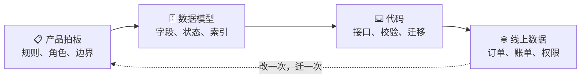

# 产品岗不是「画原型、写文档」

后端看产品，看得见的是画原型、写 PRD、开会、催进度。于是不少后端转全栈时，对产品这块的态度是：大概知道要做什么就行，原型画个框、文档写个大概，剩下的边做边看。

这是最大的误区。

**产品岗的内核是决策，不是表达。** 而且它做的决策，大部分最后会变成你后端的约束——你踩的坑，往前追三代，很多都追到产品阶段某个拍脑袋的决定上。

下面这几件事，但凡做过几个项目，应该都熟：

| 你在技术侧踩的坑       | 往前追，追到哪                  |
| -------------- | ------------------------ |
| 建表时发现「状态」不够用   | 产品只写了成功路径，异常态和中间态没提      |
| 上线一段时间，历史订单全变了 | 产品让规则「可配置」，没说历史数据怎么办     |
| 免费版限流天天出 bug   | 「按月限 N 单」的跨月边界、退款都没定     |
| 权限系统做到一半推倒重来   | 一开始说「就两种角色」，后来要「每个客户自定义」 |

这些都不是技术问题。是产品决策没做透，把不确定性整包甩给了技术。

## 所以这里只讲三件事 🎯

1. 🧠 **产品岗真正在决策什么**——六个知识模块
2. ⚖️ **每个决策点上有哪些选项、代价分别是什么**——选型维度表
3. 🕳️ **每个决策会给技术埋什么坑**——决策 → 技术后果映射表


一句话：你不是要当产品经理。你要能判断「这个产品决策，技术接不接得住，要付什么代价」。

