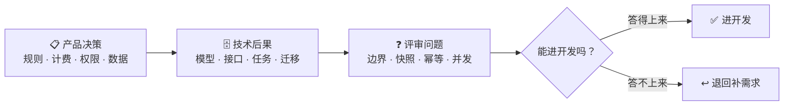

# 产品决策 → 技术后果：一张 checklist

这是这部分最值钱的一张表。左边是产品常见的决策，右边是它给技术埋的坑。需求评审时拿这张表逐条问，能挡掉 80% 的后期返工。

## 映射表 📋

| 产品决策       | 技术后果                    | 评审时该问什么                     |
| ---------- | ----------------------- | --------------------------- |
| 规则可配置      | 规则引擎或配置表 + 测试组合爆炸       | 会有客户用不同值吗？组合谁来测？            |
| 规则会变       | 历史数据要不要快照               | 改规则后，历史订单按新规则还是旧规则？         |
| 客户免登录      | 一次性令牌 + 防重放 + 过期处理      | 令牌多久过期？能不能重复用？过期了怎么找回？      |
| 收定金 / 全款   | 支付集成 + 回调幂等 + 对账        | 回调丢了怎么办？重复回调怎么幂等？退款谁来触发？    |
| 免费版限用量     | 计量 + 配额 + 跨周期重置         | 周期按自然月还是滚动 30 天？时区按谁？退款扣不扣？ |
| 多租户        | 数据隔离 + 每个查询带 tenant\_id | 独立库还是共享表？隔离到什么粒度？           |
| 角色可自定义     | 权限快照 + 版本化              | 角色改了，历史操作记录按旧权限还是新权限？       |
| 数据可删除      | 软删 + 级联 + 备份处理          | 删除要连带哪些表？备份里的数据删不删？         |
| 支持跨时区      | 全链路 UTC + 渲染时转换         | 显示按谁的时区？夏令时怎么处理？            |
| 支持导入导出     | 异步任务 + 大文件 + 校验         | 多大文件？失败怎么重试？导出要不要限流？        |
| 消息通知       | 队列 + 重试 + 模板            | 失败重试几次？用户能不能关？通知记录存多久？      |
| 审核 / 审批流   | 状态机 + 待办 + 超时           | 审批人能改吗？超时自动通过还是驳回？          |
| 数据统计报表     | 预聚合 + 缓存 + 时区           | 实时还是 T+1？口径谁定？历史数据补不补？      |
| 软删除 vs 硬删除 | 唯一索引冲突 + 查询过滤           | 删了还能恢复吗？唯一键冲突怎么处理？          |

## 怎么用 🛠️

1. 评审前把表过一遍，圈出这次需求命中的行。
2. 会上把右列的问题当场问出来，答不上来的记下来。
3. 答不上来的那些，不是「技术太较真」，而是**需求本来就缺了一块**。补齐再进开发。


最容易翻车的一句话：「这个先简单做，以后再说。」 涉及钱、权限、状态、历史数据的事，没有「以后再说」——以后补，都是迁移。

