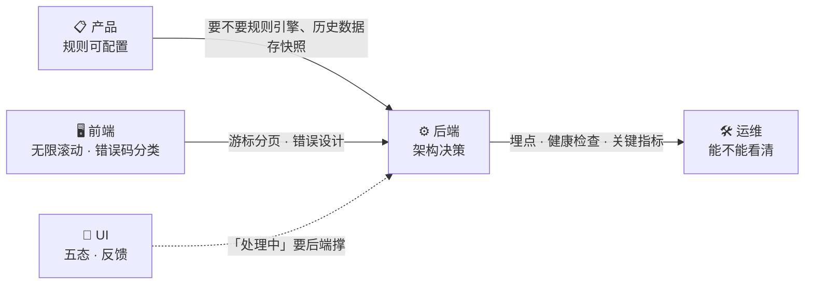

# 后端

这一章看起来最熟，但恰恰因为熟，最容易犯一个错：**把「我熟什么」当成「该选什么」。**

语言、框架、数据库是后端选型的表层。真正决定架构能不能撑住业务的，是另外几层：多租户隔离、并发正确性、幂等、状态机、缓存一致性、队列异步、可观测性、部署架构。这些层和语言无关，Go / Python / Java 都能做，但**做错的方式各不相同**。

而作为全栈，你比纯后端多一个视角：**后端选型要同时接住产品、UI、前端、运维四方的约束。**

这几件事，纯后端想不到，纯产品也想不到。

<table data-view="cards"><thead><tr><th></th><th></th><th></th><th data-hidden data-card-target data-type="content-ref"></th></tr></thead><tbody><tr><td><h3>🧭</h3></td><td><strong>后端选型不是「选个语言框架」</strong></td><td>真正的七层决策、四方约束怎么落到后端，以及为什么熟手反而更容易选错。</td><td><a href="hou-duan-xuan-xing-bu-shi-xuan-ge-yu-yan-kuang-jia.md">hou-duan-xuan-xing-bu-shi-xuan-ge-yu-yan-kuang-jia.md</a></td></tr><tr><td><h3>🧠</h3></td><td><strong>后端岗的八个模块</strong></td><td>多租户隔离、并发正确性、幂等、状态机、缓存一致性、队列异步、可观测性、部署架构。每个都写了「全栈视角为什么必须懂」。</td><td><a href="hou-duan-gang-de-ba-ge-mo-kuai.md">hou-duan-gang-de-ba-ge-mo-kuai.md</a></td></tr><tr><td><h3>⚖️</h3></td><td><strong>选型表：九张表 + 三语言对照</strong></td><td>同一个决策，Go / Python / Java 各自怎么解、代价是什么。查表用。</td><td><a href="hou-duan-xuan-xing-biao.md">hou-duan-xuan-xing-biao.md</a></td></tr><tr><td><h3>🕳️</h3></td><td><strong>后端决策 → 技术后果：映射表</strong></td><td>15 个后端决策，分别给前端、运维埋什么坑，评审时该问什么。</td><td><a href="hou-duan-jue-ce-ji-shu-hou-guo.md">hou-duan-jue-ce-ji-shu-hou-guo.md</a></td></tr><tr><td><h3>🪤</h3></td><td><strong>后端岗的十二个通用坑</strong></td><td>漏带 tenant_id、先查再插、回调不去重、过早拆微服务……每条说清表现、后果、怎么防。</td><td><a href="hou-duan-gang-de-shi-er-ge-keng.md">hou-duan-gang-de-shi-er-ge-keng.md</a></td></tr><tr><td><h3>💬</h3></td><td><strong>提问模板：架构、契约、验收</strong></td><td>多租户隔离、并发防冲突、幂等、接口契约、缓存、部署架构、可观测性、AI 代码验收。</td><td><a href="hou-duan-ti-wen-mu-ban.md">hou-duan-ti-wen-mu-ban.md</a></td></tr></tbody></table>

## 建议读法 🛣️

* **刚接手后端项目**：先读[后端选型不是「选个语言框架」](hou-duan-xuan-xing-bu-shi-xuan-ge-yu-yan-kuang-jia.md)，再看[十二个坑](hou-duan-gang-de-shi-er-ge-keng.md)。
* **要和前端一起定接口**：直接看[映射表](hou-duan-jue-ce-ji-shu-hou-guo.md)，再拿[模板四](hou-duan-ti-wen-mu-ban.md)过一遍自己的接口设计。
* **验收 AI 写的后端**：用[模板八](hou-duan-ti-wen-mu-ban.md)逐条自查，对着[八个模块](hou-duan-gang-de-ba-ge-mo-kuai.md)看有没有漏掉哪一层。


这条线上最容易被低估的是**可观测性**。后端觉得「监控是运维的事」，运维觉得「我不知道你的业务该监控什么」。全栈的人要主动划边界：我埋什么，你接什么。这件事不做，前面七层做得再好，出事时也看不清。

