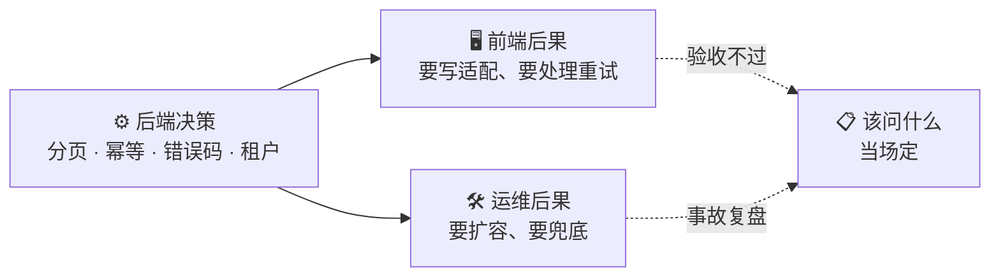

# 后端决策 → 技术后果：映射表

左边是后端常见决策，中间是对前端、运维的后果，右边是评审时该问的问题。

| #  | 后端决策         | 前端后果        | 运维后果          | 该问什么                           |
| -- | ------------ | ----------- | ------------- | ------------------------------ |
| 1  | 多租户共享表       | 接口要带租户上下文   | 要监控租户资源占用     | 有没有 RLS 兜底？漏写 `tenant_id` 怎么防？ |
| 2  | 错误码不分类       | 前端没法归一      | —             | 错误码怎么分（业务 / 系统 / 权限 / 校验）？     |
| 3  | 分页用 offset   | 无限滚动会重复、漏数据 | —             | 支持 cursor 分页吗？                 |
| 4  | 写操作无幂等       | 前端重试不安全     | 运维重试不安全       | 有幂等键吗？                         |
| 5  | 接口返回不统一      | 前端要写适配      | —             | 返回结构统一吗？                       |
| 6  | 同步长任务        | 前端请求超时      | 要扩容扛长请求       | 能异步化吗？有任务状态查询吗？                |
| 7  | 无缓存          | —           | 库压力大，要扩容、成本高  | 读多写少吗？值得加缓存吗？                  |
| 8  | 缓存策略不一致      | 前端看到旧数据     | —             | 先更新库还是先删缓存？一致性要求？              |
| 9  | 无队列          | —           | 高峰扛不住，要扩容     | 需要削峰吗？                         |
| 10 | 队列无幂等        | 前端出现重复操作结果  | 重复执行          | 消费者幂等吗？                        |
| 11 | 无健康检查        | —           | 没法做存活 / 就绪探针  | 有 `/health`、`/ready` 吗？        |
| 12 | 无业务指标        | —           | 只能监控 CPU / 内存 | 关键业务指标埋了吗？                     |
| 13 | 无 `trace_id` | 前端报错没法追     | 排查困难          | 日志带 `trace_id` 吗？跨服务透传吗？       |
| 14 | 单体拆微服务       | 前端要处理多服务    | 运维复杂度翻倍       | 真的需要拆吗？团队养得起吗？                 |
| 15 | 状态变更不留事件     | 前端只能看当前态    | 故障无法追溯        | 有没有事件日志（谁、何时、从什么到什么）？          |

## 怎么用 📋

技术方案评审时，**从上到下过一遍左列**。命中的那几行，把右列的问题当场问出来，前后端和运维一起对答案。


这张表真正值钱的是**中间两列**。「后端用什么分页」谁都会争；「offset 分页会让无限滚动出现重复数据」这句话拿出来，争议就结束了。

