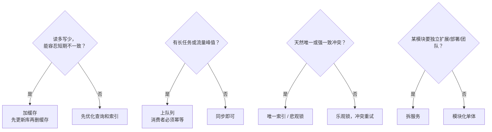

# 选型表：九张表 + 三语言对照

每张表都带**三语言对照小注**——同一个决策，Go / Python / Java 三种生态怎么解、各自代价是什么。查表用，不用通读。


表里的库和框架是常见选择，不是唯一答案。书的自我约束里明确写了「不把某个框架说成唯一正确答案」——这里也一样，按团队现状挑。


## 表一：语言与框架选型

| 维度      | Go                 | Python                   | Java                              |
| ------- | ------------------ | ------------------------ | --------------------------------- |
| 适合什么    | 高并发、基础设施、云原生       | 快速开发、AI / 数据、脚本          | 企业级、大团队、复杂业务                      |
| Web 框架  | Gin / Echo / Fiber | FastAPI / Django / Flask | Spring Boot / Quarkus / Micronaut |
| 并发模型    | goroutine（轻量）      | asyncio / 多进程            | 线程池 / 虚拟线程（Java 21+）              |
| 类型系统    | 静态、强               | 动态（可加 type hint）         | 静态、强                              |
| 启动速度    | 快                  | 快                        | 较慢（JVM；Quarkus 有改善）               |
| 内存占用    | 低                  | 中                        | 高（JVM）                            |
| AI 生成质量 | 高                  | 很高                       | 很高                                |
| 生态成熟度   | 中高（云原生强）           | 高（AI / 数据强）              | 很高（企业级强）                          |
| 典型坑     | 错误处理冗长、泛型较弱        | GIL（CPU 密集场景）、类型松散       | 启动慢、内存大、配置复杂                      |

**判断心法**：别换语言，用你团队最熟的。语言切换的成本是团队成本，不是技术成本。真要选：高并发 / 基础设施 → Go；AI / 数据 / 快速原型 → Python；企业级 / 大团队 → Java。

**AI 时代加一条**：三种语言的 AI 生成质量都很高。Python 和 Java 的生态文档更全，生成更稳；Go 也不错，但在一些冷门库上会差一些。

## 表二：数据库选型

| 维度      | PostgreSQL          | MySQL      | MongoDB         | 其他               |
| ------- | ------------------- | ---------- | --------------- | ---------------- |
| 适合什么    | 复杂查询、JSONB、RLS、范围类型 | 通用、生态广、运维熟 | 文档型、schema 灵活   | 按场景（时序 / 图 / 搜索） |
| 多租户 RLS | 原生支持                | 应用层兜底      | 应用层兜底           | —                |
| 事务      | 强                   | 强（InnoDB）  | 有限（4.0+ 支持）     | —                |
| 扩展      | 强（扩展丰富）             | 中          | 分片原生            | —                |
| 典型坑     | 连接数、vacuum          | 大表 DDL、字符集 | 无 schema 导致数据混乱 | —                |

**三语言对照**

* **Go**：`database/sql` + `pgx`（Postgres）/ `go-sql-driver/mysql`；ORM 用 GORM，或 `sqlc`（SQL 优先）
* **Python**：SQLAlchemy（全能）/ Django ORM（绑 Django）/ asyncpg（异步 Postgres）
* **Java**：JPA / Hibernate（全自动）/ MyBatis（SQL 可控）/ jOOQ（类型安全 SQL）

**判断心法**：默认 PostgreSQL——多租户 RLS、JSONB、范围类型、扩展性都强，是 SaaS 最优起点。MySQL 也行，但 RLS 要在应用层兜底。文档型只在 schema 真的频繁变时才考虑。

## 表三：多租户隔离方案

| 方案                | 隔离强度 | 成本 | 三语言实现要点                                                                       |
| ----------------- | ---- | -- | ----------------------------------------------------------------------------- |
| 独立库               | 最强   | 最高 | 连接池管理多库（Go：连接池 map；Python：多 engine；Java：多 DataSource）                         |
| 独立 schema         | 强    | 中高 | 动态 schema 切换（Go：`search_path`；Python：`schema_translate_map`；Java：多 schema 配置） |
| 共享表 + `tenant_id` | 弱    | 最低 | ORM 统一加租户条件 + RLS 兜底                                                          |

**三语言对照要点**

* **Go**：GORM 有租户插件；`sqlc` 要手写租户条件，建议中间件统一注入
* **Python**：SQLAlchemy 用 `with_loader_criteria` 做全局过滤；Django 要自定义 Manager
* **Java**：Hibernate 6 的 `@Filter` / `@TenantId`；MyBatis 要拦截器统一加条件

**判断心法**：默认共享表 + `tenant_id` + RLS。什么时候升级？当**某个客户要求物理隔离**或**合规要求**时，给这个大客户单独开库——混合模式：多数共享，少数独立。

## 表四：并发防冲突方案

| 方案   | 适合什么 | 三语言实现要点                                                                     |
| ---- | ---- | --------------------------------------------------------------------------- |
| 唯一索引 | 天然唯一 | 三语言都是数据库约束 + 捕获异常                                                           |
| 悲观锁  | 冲突频繁 | Go：`SELECT FOR UPDATE`；Python：`with_for_update()`；Java：`@Lock(PESSIMISTIC)` |
| 乐观锁  | 冲突少  | 版本号字段 + 更新时校验（三语言都手动或框架支持）                                                  |
| 分布式锁 | 跨服务  | Redis（Redlock）/ etcd / ZooKeeper                                            |

**判断心法**：能用数据库约束就用数据库。跨服务才上分布式锁，而且要处理锁失效和脑裂。

## 表五：幂等实现

| 方案    | 适合什么   | 三语言实现要点                           |
| ----- | ------ | --------------------------------- |
| 幂等键   | 写操作通用  | Redis / DB 存 key + 状态；三语言都靠中间件或手动 |
| 唯一约束  | 天然唯一业务 | 数据库约束 + 捕获重复异常                    |
| 状态机校验 | 有状态流转  | 状态转换白名单，三语言都靠业务代码                 |

**判断心法**：支付回调、消息消费、写接口，一律做幂等。幂等键是最通用的方案。

## 表六：缓存策略

| 策略       | 适合什么   | 三语言实现要点                                                  |
| -------- | ------ | -------------------------------------------------------- |
| 先更新库再删缓存 | 大多数场景  | 三语言都靠代码 + 重试 / 延迟双删                                      |
| 只更新库靠过期  | 一致性要求低 | 简单                                                       |
| 多级缓存     | 高并发    | 本地缓存（Go：bigcache；Python：cachetools；Java：Caffeine）+ Redis |

**判断心法**：读多写少才加缓存，而且先优化查询和索引。缓存加早了 = 多一个 bug 源。

## 表七：队列与异步

| 选项                       | 适合什么   | 三语言生态                                             |
| ------------------------ | ------ | ------------------------------------------------- |
| Redis 队列                 | 轻量、简单  | Go：asynq；Python：RQ / Dramatiq；Java：Spring + Redis |
| 专业消息队列（Kafka / RabbitMQ） | 高吞吐、可靠 | 三语言都有成熟客户端                                        |
| 数据库轮询                    | 极简、量小  | 三语言都简单，但要防重复                                      |

**判断心法**：量小用数据库轮询或 Redis 队列，量大用 Kafka / RabbitMQ。消费者必须幂等。

## 表八：可观测性

| 维度 | 三语言生态                                                          |
| -- | -------------------------------------------------------------- |
| 指标 | Go：Prometheus client；Python：prometheus\_client；Java：Micrometer |
| 日志 | 结构化日志（Go：zap / zerolog；Python：structlog；Java：Logback + JSON）   |
| 链路 | OpenTelemetry（三语言都支持）                                          |

**判断心法**：OpenTelemetry 是跨语言标准，三语言都选它，避免被锁定。

## 表九：部署架构

| 架构         | 适合什么   | 三语言要点                                              |
| ---------- | ------ | -------------------------------------------------- |
| 单体 Docker  | 小团队、早期 | 三语言都能打小镜像（Go 最小，Java 用 JRE / native，Python 用 slim） |
| 模块化单体      | 中小团队   | 靠模块边界和依赖管理                                         |
| 微服务        | 大团队    | 三语言都要处理分布式问题                                       |
| Serverless | 流量波动   | Go / Python 冷启动快，Java 冷启动慢（Quarkus 有改善）            |

**判断心法**：默认单体或模块化单体。什么时候拆？**某个模块要独立扩展 / 部署 / 团队**时。

## 一张速查图 🗺️

