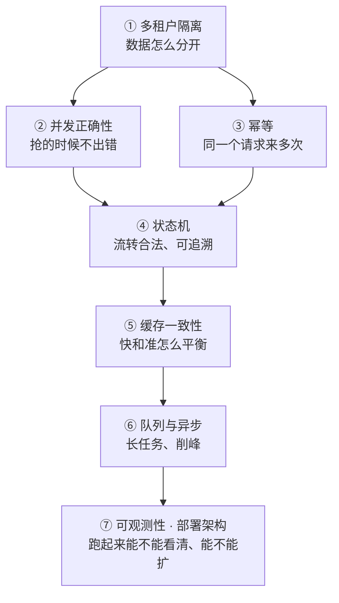

# 后端选型不是「选个语言框架」

你干了多年后端，这一章看着最熟。但恰恰因为熟，最容易犯一个错：**把「我熟什么」当成「该选什么」。**

语言、框架、数据库，是后端选型的表层。真正决定架构能不能撑住业务的，是另外几层：

这七层和语言无关。Go、Python、Java 都能做，但**做错的方式各有不同**——这正是「选型表」那篇里的三语言对照要解决的问题。

## 作为全栈，你多出来的那个视角 🔍

纯后端只看「系统怎么扛住」。你还要同时接住另外四方的约束：

| 谁提出    | 提出什么    | 落到后端是什么                      |
| ------ | ------- | ---------------------------- |
| 📋 产品  | 规则可配置   | 要不要规则引擎？历史数据存不存快照？           |
| 🖥️ 前端 | 无限滚动    | 分页必须支持游标，不能只给 offset         |
| 🖥️ 前端 | 错误码分类   | 接口的错误设计要重做，不能只回 `{code: -1}` |
| 🎨 UI  | 「处理中」状态 | 长任务得异步化，还要给任务状态查询            |
| 🛠️ 运维 | 要可观测    | 你要埋点、给健康检查、定义关键指标            |


这五件事，纯后端想不到，纯产品也想不到。**只有站在全栈位置上的人，才能在评审那一刻一次问对。**


## 这一章讲三件事 🎯

1. **后端岗真正在决策什么** —— 八个模块，语言无关的知识内核
2. **每个决策点有哪些选项、代价是什么** —— 九张选型表，每张带三语言对照
3. **每个后端决策会给前端、产品、运维埋什么坑** —— 全栈视角最值钱的部分

## 一个你一定见过的例子 🔍

| 症状                  | 表面原因      | 真正没做的决策                        |
| ------------------- | --------- | ------------------------------ |
| 两个用户同时抢到同一个时段       | 「代码有 bug」 | 并发正确性：靠「先查再插」，没上唯一索引           |
| 支付平台重发回调，发了两次货      | 「平台不稳定」   | 幂等：回调没落原始事件、没按事件 ID 去重         |
| 前端列表滚动时重复出现同一条数据    | 「前端写错了」   | 接口设计：只给了 offset 分页             |
| 一个大客户查数据，把别的客户也带出来了 | 「测试没覆盖」   | 多租户：查询漏了 `tenant_id`，没有 RLS 兜底 |


一句话记住：**你不是要学新的后端技术，你要把已有的后端能力，升级成「能接住四方约束的架构决策能力」。**

