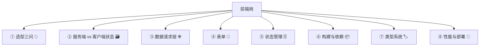

# 前端岗的八个模块

每块都标一句「后端为什么必须懂」——这里的「后端」也包括你作为后端出身的全栈：哪些思维能直接迁移，哪些是盲区。

## 模块一：选型三问 —— 决定 80% 的框架选择 🧭

**知识内核**

前端选型，先问三个问题，答案能砍掉 80% 的选项：

* **要不要被搜索引擎收录（SEO）？** 要 → 不能纯 SPA，要 SSR/SSG。不要 → SPA 也行。
* **首屏要多快？** 要求高 → SSR/SSG + 代码分割 + 资源优化。要求一般 → SPA 也能接受。
* **有没有重交互页？** 有 → 要有成熟的状态管理和数据请求方案。没有（以读为主）→ 可以极简。

这三个问题的组合，基本决定了框架和渲染模式：

| SEO | 首屏 | 重交互 | 倾向                              |
| --- | -- | --- | ------------------------------- |
| 要   | 高  | 有   | Next.js / Nuxt（SSR/SSG + 客户端交互） |
| 要   | 高  | 无   | 静态站点生成（SSG）                     |
| 不要  | 高  | 有   | Next.js / Remix（SPA 也能做，但要优化）   |
| 不要  | 一般 | 有   | Vite + React/Vue SPA            |
| 不要  | 一般 | 无   | 极简 SPA 或纯静态                     |

**后端为什么必须懂**

因为渲染模式决定后端要不要参与渲染，也决定部署架构。

* SSR 意味着有一个 Node 服务在渲染页面，它要调你的接口、要处理 cookie、要处理鉴权。这和纯静态托管是两个部署形态。
* SSG 意味着页面在构建时生成，内容更新要重新构建。这对「内容频繁变」的产品不合适。

这个决策是不可逆的，因为它决定部署架构、决定鉴权方式、决定性能优化方向。选错了，后期迁移要重写页面。

一个反直觉的结论：后端出身的你，容易高估 SSR 的价值。SSR 解决的是「SEO + 首屏」，如果你的产品是后台管理、内部工具，根本不需要 SEO，纯 SPA 更简单、更好维护。


别为了「显得专业」上 SSR，那是给自己找运维负担。


## 模块二：服务端状态 vs 客户端状态 —— 最容易混的一层 🗃️

**知识内核**

这是后端转前端最容易懵、也最该用后端思维理解的一层。

前端的状态分两类，处理方式完全不同：

| 类型    | 是什么                        | 后端类比      | 谁管                        |
| ----- | -------------------------- | --------- | ------------------------- |
| 服务端状态 | 从后端拿来的数据（列表、详情、用户信息）       | 缓存（Redis） | 请求库（TanStack Query / SWR） |
| 客户端状态 | 页面自己的 UI 状态（弹窗开关、表单输入、选中项） | 内存变量      | 组件 state / 全局 store       |

关键区别：

* **服务端状态是「缓存」**：它有新鲜度（缓存多久）、失效（什么时候重新拉）、同步（多个页面用同一份数据，怎么保持一致）的问题。这些和 Redis 缓存的问题一模一样。
* **客户端状态是「内存变量」**：只在当前会话有效，不需要持久化、不需要失效，页面刷新就没了。

最常见的错误，是把服务端状态塞进全局 store。比如把用户列表放进 Redux，然后手动管理「什么时候重新拉、什么时候失效、多个页面怎么同步」——这就是在手写一个缓存系统，而请求库已经帮你做好了。结果是缓存永远不同步、bug 层出不穷。

**后端为什么必须懂**

因为你有缓存的直觉，这是你的优势。你理解缓存穿透、击穿、雪崩、失效、一致性，迁移到前端就是「服务端状态的缓存策略」。你只需要做一件事：把服务端状态交给请求库，别自己管。

反过来，前端出身的人容易把两者混在一起，导致状态管理越来越乱。你能用缓存思维一眼看出问题。

## 模块三：数据请求层 —— 前端最像后端的地方 🌐

**知识内核**

数据请求层是前端的「数据访问层」，它要解决六件事：

1. **请求封装**：统一 baseURL、超时、重试、取消。
2. **鉴权拦截**：token 怎么带、过期怎么刷新、401 怎么处理。
3. **错误归一**：把后端的各种错误码，归成前端能处理的几类（业务错误、系统错误、权限错误、网络错误）。
4. **缓存与失效**：什么数据缓存多久、什么时候重新拉、多个页面怎么共享。
5. **并发控制**：重复请求去重、竞态取消、批量请求。
6. **乐观更新**：先改 UI 再发请求，失败回滚（提升体验，但要处理好回滚）。

**后端为什么必须懂**

因为数据请求层是前后端契约的落地处，而且它直接暴露后端接口设计的问题：

| 后端的问题      | 前端接到的后果        |
| ---------- | -------------- |
| 错误码不分类     | 前端没法归一，只能给笼统提示 |
| 分页用 offset | 无限滚动会重复 / 漏数据  |
| 接口返回结构不统一  | 前端要写一堆适配代码     |
| 没有幂等设计     | 前端重复提交就出问题     |

全栈在这里最该做的事，是「接口设计时考虑前端怎么用」：

* 错误码要能分类（业务 / 系统 / 权限 / 校验），前端才能给不同提示。
* 分页要支持游标（cursor），前端才能做无限滚动。
* 接口返回结构要统一（`{data, error, meta}`），前端才能写统一的数据请求层。
* 写操作要支持幂等键，前端重试才安全。

一句话：前端数据请求层的复杂度，八成是后端接口设计的债。

## 模块四：表单 —— 前后端校验规则重复最多的地方 📝

**知识内核**

表单是前端最复杂的交互，因为它集齐了：校验、提交、回显、错误映射、联动、异步校验。

* **校验**：前端校验（即时反馈）+ 后端校验（最终权威）。两者规则要一致，否则用户前端过了、后端拒了，体验崩。
* **校验规则共享**：用 zod / yup 这类 schema，前后端共享同一份规则，是最大的工程收益。
* **提交**：loading、防重复提交、超时、失败重试、成功跳转。
* **回显**：编辑时数据回填、字段格式转换（时间、金额、枚举）。
* **错误映射**：后端返回的字段级错误，要能映射到对应表单项。
* **联动**：字段 A 变了，字段 B 的选项 / 校验要变。

**后端为什么必须懂**

因为表单是前后端校验规则重复最多的地方，而且后端的错误返回格式直接决定前端表单体验：

* 后端只返回 `{code: -1, msg: "参数错误"}` → 前端不知道哪个字段错了，只能笼统提示。
* 后端返回字段级错误 `{errors: {phone: "手机号格式错误"}}` → 前端能精确标红。
* 后端校验规则和前端不一致 → 用户前端过了、后端拒了，骂前端。

全栈在这里的价值：用 schema 共享校验规则。zod 这类库，前后端都能用，规则写一次，两边都生效。这是后端转全栈最容易拿到的「降维打击」——你本来就懂校验，只是换了个地方写。

## 模块五：状态管理 —— 决定「状态放哪」 🗄️

**知识内核**

状态管理不是「上不上 Redux」，是「状态放哪」的判断：

| 状态放哪                      | 适合什么        | 代价          |
| ------------------------- | ----------- | ----------- |
| 组件本地 state                | 只在这个组件用     | 跨组件共享要提升    |
| 提升到父组件                    | 兄弟组件共享      | 层级深了要透传     |
| Context                   | 跨层级共享、变化不频繁 | 变化频繁会全量重渲染  |
| 全局 store（Zustand / Redux） | 跨页面共享、复杂逻辑  | 容易滥用，什么都往里塞 |
| URL（query / params）       | 可分享、可刷新保持   | 复杂状态不适合     |
| 服务端状态库                    | 后端数据        | 见模块二        |

判断标准（按顺序问）：

1. 是后端数据吗？是 → 请求库，不进 store。
2. 只在这个组件用吗？是 → 本地 state。
3. 需要跨页面 / 刷新保持吗？是 → URL 或持久化。
4. 变化频繁吗？频繁 → 别用 Context，用 store 或本地。
5. 以上都不是 → 提升到最近公共父组件。

**后端为什么必须懂**

因为你有作用域思维：变量的作用域越小越好，全局变量是万恶之源。迁移到前端：状态的作用域越小越好，全局 store 是万恶之源。

前端最常见的烂项目，就是「什么都往全局 store 塞」。这和后端「什么都用全局变量」是同一个病。

## 模块六：构建与依赖 —— 前端的「编译打包」 📦

**知识内核**

* **构建工具**：Vite（开发快）、Webpack（成熟）、Turbopack（新）、Rspack（快）。选型看生态和团队。
* **构建产物**：开发环境（不压缩、热更新）、生产环境（压缩、代码分割、tree-shaking、资源 hash）。
* **依赖管理**：package.json + 锁文件。锁文件必须提交，否则构建不可复现（类比后端的 go.sum / pom.lock）。
* **幽灵依赖**：没在 package.json 里声明，但因为依赖的依赖被装上了，直接用会出问题。用 pnpm 能缓解。
* **环境变量**：构建时注入，注意哪些能暴露到前端（NEXT\_PUBLIC\_ 之类），哪些绝不能（密钥）。
* **代码分割**：按路由 / 按需加载，控制首屏包体积。

**后端为什么必须懂**

因为构建就是前端的编译打包，你完全可以用后端思维理解：

| 后端概念                 | 前端对应               |
| -------------------- | ------------------ |
| 编译                   | 构建（build）          |
| 依赖管理（Maven / go mod） | package.json + 锁文件 |
| Checkstyle / Lint    | ESLint + Prettier  |
| 制品（jar / war）        | dist 产物            |
| 环境配置（profile）        | 环境变量               |
| 多模块                  | monorepo / 代码分割    |


最容易踩的坑：环境变量暴露密钥。前端构建产物是公开的，任何 `NEXT_PUBLIC_` / `VITE_` 开头的变量都会打进包里，用户能直接看到。密钥绝不能放前端，这是安全红线。


## 模块七：类型系统 —— 前后端共享类型的价值 🏷️

**知识内核**

* TypeScript 的价值不是「类型安全」这么抽象，是改代码时不怕改错。改一个字段名，编译器告诉你哪些地方要改。
* 类型来源：手写、从后端 schema 生成（OpenAPI → TS）、从数据库生成（Prisma → TS）。
* 前后端共享类型：后端定义 schema（OpenAPI / zod / GraphQL），前端生成类型，接口改了前端编译就报错。这是最大的工程收益。
* 类型的度：不用追求「类型完美」，追求「关键路径有类型」（接口、表单、状态）。

**后端为什么必须懂**

因为类型是前后端契约的载体。你后端定义接口，如果只写文档，前端永远对不上；如果定义成 schema（OpenAPI），前端能生成类型，契约就固化了。

全栈在这里的价值：后端用 OpenAPI / zod 定义接口，前端生成类型，接口变更自动暴露问题。这是后端转全栈最容易拿到的第二个「降维打击」——你本来就懂接口契约，只是换了个载体。

## 模块八：性能与部署模式 —— 决定「快不快、怎么上」 🚀

**知识内核**

Core Web Vitals：三个核心指标。

| 指标  | 衡量什么   | 用户感受    |
| --- | ------ | ------- |
| LCP | 最大内容绘制 | 首屏快不快   |
| INP | 交互响应   | 点了有没有反应 |
| CLS | 布局偏移   | 页面跳不跳   |

优化要对着指标做，不是凭感觉。

* **性能优化手段**：图片优化（格式 / 尺寸 / 懒加载）、字体优化（子集化 / font-display）、代码分割、预加载、缓存策略、CDN。
* **性能预算**：给首屏包体积、请求数、LCP 定一个预算，超了就砍功能。
* **部署模式**：静态托管（CDN 分发，简单、便宜、快）、SSR 服务（Node 渲染，要运维、要扩容、要处理冷启动）、边缘渲染（CDN 边缘跑渲染，快但受限）、Serverless（按需扩容，冷启动和长任务受限）。

**后端为什么必须懂**

因为部署模式决定运维成本和架构：

* 纯静态托管，运维几乎为零（CDN + 对象存储）。
* SSR 服务，要像运维后端一样运维它（扩容、监控、日志、冷启动）。

这个决策是不可逆的（和 UI 的 token 一样），因为它决定部署架构。

一个后端最容易忽略的点：SSR 服务的「渲染」本身也是后端逻辑，它要调接口、要处理鉴权、要处理超时。SSR 服务挂了，整个前端都打不开，这是后端必须纳入监控和容量规划的。
