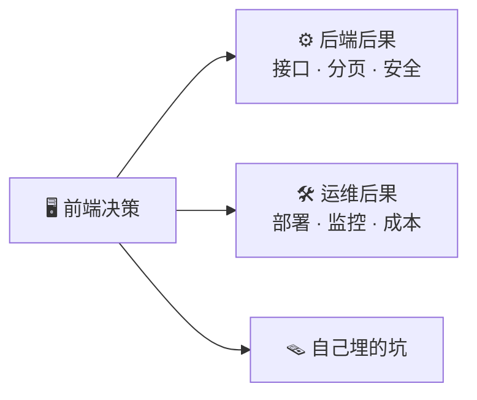

# 前端决策 → 技术后果：映射表

左边是前端常见决策，右边是它给后端、运维、以及你自己埋的坑。

| 前端决策                 | 后端后果                 | 运维 / 架构后果  | 该问什么                      |
| -------------------- | -------------------- | ---------- | ------------------------- |
| 纯 SPA                | 接口要支持跨域 / CORS       | 静态托管，简单    | 要不要 SEO？                  |
| SSR                  | 要 Node 服务、要调接口、要处理鉴权 | 要监控、扩容、回滚  | SSR 服务挂了怎么办？              |
| 无限滚动                 | 必须游标分页               | —          | 分页用 cursor 还是 offset？     |
| 大量筛选排序               | 查询参数复杂、要索引           | —          | 筛选项对应哪些索引？                |
| 实时功能（WebSocket）      | 长连接、消息广播             | 连接数、扩容、重连  | 用 WS 还是 SSE？断线重连？         |
| 文件上传                 | 对象存储、分片合并、校验         | 存储成本、CDN   | 多大？断点续传？                  |
| 富文本                  | 内容存储格式、XSS 清洗        | —          | 存 HTML 还是结构化？             |
| 多语言                  | 字段多语言存储              | —          | 语言存哪？默认语言？                |
| 错误码不分类               | 前端没法归一               | —          | 错误码怎么分？                   |
| 接口返回不统一              | 前端要写适配               | —          | 返回结构统一吗？                  |
| 写操作无幂等               | 前端重试不安全              | —          | 支持幂等键吗？                   |
| token 存 localStorage | XSS 风险               | 安全审计       | 存 cookie 还是 localStorage？ |
| 环境变量带密钥              | 泄露                   | 安全红线       | 有没有密钥进前端包？                |
| 类型不共享                | 接口变更对不上              | —          | 用 OpenAPI 生成类型吗？          |
| 前端包太大                | —                    | 首屏慢、CDN 成本 | 性能预算多少？                   |
| 测试只测 happy path      | 回归风险                 | —          | 核心路径有 E2E 吗？              |

## 怎么用 📋

技术方案评审时过一遍左列，前后端一起对右列问题。命中的，当场定。


这张表最值钱的是中间两列。左列是前端自己的事，中间两列是「前端一决定，后端和运维就要跟着改」的部分——这才是你作为全栈该盯的。

