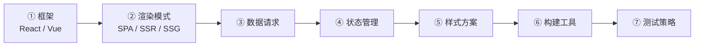
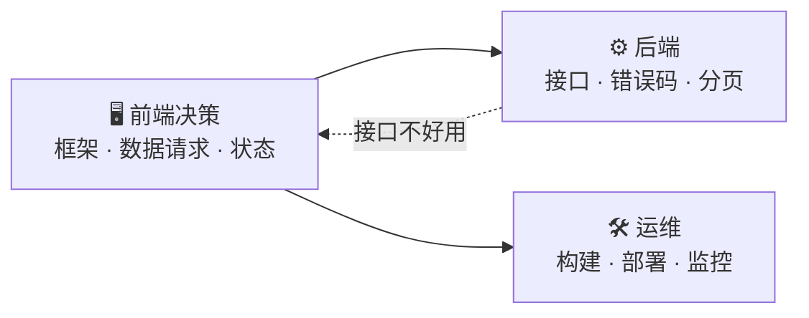

# 前端选型不是「选个框架」

后端看前端，最容易把它简化成「用 React 还是 Vue」。于是态度是「选个主流的，跟着 AI 写就行」。

这个简化有两个问题。

**第一，框架只是前端选型里的一层。** 前端选型至少有七层：

框架选对了，后面六层选错，一样翻车。而且后面六层比框架更不可逆——框架换起来是重写页面；数据请求层和状态管理选错，是改每一个页面，成本更高。

**第二，框架选型在 AI 时代已经不是最重要的了。** AI 对主流框架的生成质量都很高，你写 React 还是 Vue，AI 都能给你七十分起步的代码。真正决定「能不能维护、能不能改」的，是数据请求层和状态管理——这两层 AI 生成质量最不稳定，也最容易埋雷。

## 一个你一定见过的例子 🔍

一个前端项目，页面都能跑，但越改越慢、越改越乱。你以为是「前端代码写得不好」，其实通常是三件事：

| 😵 你看到的现象 | 🎯 真正的原因        |
| --------- | --------------- |
| 越改越慢      | 服务端数据和客户端数据混在一起 |
| 越改越乱      | 每个页面各写各的请求逻辑    |
| 改一处崩三处    | 状态散落在几十个组件里     |

三件全是架构问题，不是「代码风格」问题。

## 这一节讲三件事 🎯

1. 🧠 **前端岗真正在决策什么**——八个模块
2. ⚖️ **每个决策点上有哪些选项、代价是什么**——选型表
3. 🕳️ **每个前端决策会给后端和运维埋什么坑**——映射表


一句话：你不是要当前端专家。你要能判断——这个前端方案，后端接得住吗、AI 生成得出来吗、运维扛得住吗、怎么验收。

