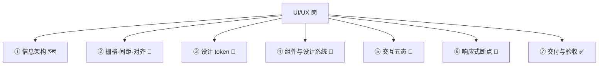
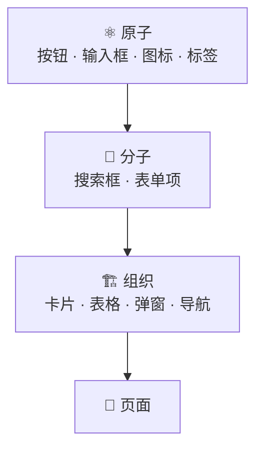

# UI/UX 岗的七个模块

每块都标一句「为什么你作为全栈必须懂」——这里的「后端」泛指你的技术视角。

## 模块一：信息架构 🗺️

**知识内核**

信息架构（IA）：一个页面里有哪些信息、怎么组织、怎么分层。IA 决定「页面上有什么」，视觉设计决定「长什么样」。IA 错了，视觉再美也救不回来。

优先级三原则：

* **一个页面一个主任务**：用户来这页是干嘛的？主任务要最显眼。
* **视觉层级**：主任务 > 辅助信息 > 次要操作。用大小、颜色、位置区分，不是把所有东西都放大。
* **渐进披露**：不常用的、复杂的收起来，别一屏全铺开。

导航结构：扁平还是层级、顶部还是侧边、要不要面包屑。判断依据是「信息深度」和「用户任务频率」。

**后端为什么必须懂**

因为信息架构直接对应数据结构和接口设计。

* 一个页面要展示哪些信息 → 接口要返回哪些字段。IA 没定，字段就定不下来，后端只能猜，猜多了就是一堆冗余字段。
* 信息有主次 → 接口要不要「分主次返回」。主信息一次返回，次要信息懒加载——这是性能优化的起点。
* 渐进披露 → 要不要拆接口。收起的内容往往可以后加载，拆成两个接口比一个大接口更灵活。

IA 没想清楚，后端的典型症状是：字段越加越多、前端开始「一个页面调五个接口」、性能越来越差。根子不在接口，在 IA。

## 模块二：栅格、间距、对齐 📐

**知识内核**

这一节是整章最「实」的部分。90% 的「丑」来自这三件事没定，不是来自审美。

* **栅格**：页面分几列。常见 12 列（灵活，能整除 2/3/4/6）、8 列（简单）、4 列（移动端）。作用是让所有元素有共同的对齐基准。
* **间距刻度**：所有间距只能从一套固定数值里选，比如 4 / 8 / 12 / 16 / 24 / 32 / 48 / 64。不能每个页面随手写 13px、17px、23px。刻度定了页面自然整齐，刻度不定每个页面都像不同人拼的。
* **对齐**：元素边缘要对齐，左对齐最稳，居中只适合短文本和按钮。对齐线越少，页面越干净。

**后端为什么必须懂**

这三件事是设计 token 的源头，而 token 是前端工程化的地基。

* 间距刻度 → CSS 变量 / Tailwind 的 spacing scale。设计稿没刻度，前端就得为每个页面写 magic number，后期改间距就是全量替换。
* 栅格 → 响应式断点的划分依据。
* 对齐 → 布局方案（flex / grid）的选择。

更实际的一点：**AI 生成 UI 时，你不告诉它间距刻度和栅格，它会给你一堆不成体系的数值。** 你验收看不出问题，上线后就是「哪里不对但说不上来」。

## 模块三：设计 token 🎨

**知识内核**

token 是把设计里的「原子值」定义成变量：`color-primary`、`font-size-body`、`radius-md`、`shadow-card`、`space-4`。所有组件只引用 token，不写死值。

为什么必须有：

* 主题切换（暗色模式、品牌定制）只换 token 值，不改组件。
* 一致性：所有按钮用同一个 primary，不会出现五个近似蓝。
* 工程化：token 能导出成 CSS 变量 / Tailwind config / TS 常量，设计和代码对得上。

最小 token 集：

| 类别 | 给几档            | 说明                  |
| -- | -------------- | ------------------- |
| 颜色 | 主色 / 中性色 / 语义色 | 语义色 = 成功 / 警告 / 错误  |
| 字号 | 5–7 档          | 正文、标题、辅助            |
| 字重 | 2–3 档          | 常规、中等、粗             |
| 行高 | 1–2 档          | 正文、标题               |
| 圆角 | 3–4 档          | sm / md / lg / full |
| 阴影 | 3 档            | 卡片、悬浮、弹窗            |
| 间距 | 一套刻度           | 和模块二共用              |

**后端为什么必须懂**

因为 token 是 UI 决策里最不可逆的一环。

* 没有 token，暗色模式就是「后补 = 全量返工」，每个颜色都要找出来替换，漏一个就是 bug。
* 没有 token，品牌定制做不了。B 端 SaaS 特别常见「客户要自己的主题色」，没 token 就得为每个客户改一套代码。
* 没有 token，AI 生成 UI 各写各的，颜色间距全不一致，根本没法统一验收。

一句话：**token 是 UI 的「数据模型」。** 数据模型没设计好，后面全是迁移。

## 模块四：组件与设计系统 🧱

**知识内核**

组件分层（借用原子设计）：

设计系统 = token + 组件 + 使用规范。它解决的不是「好不好看」，是「一致性 + 可维护 + 团队协作」。

**组件的状态比样式重要。** 一个按钮有默认 / 悬停 / 按下 / 禁用 / 加载 五种态，一个输入框有默认 / 聚焦 / 错误 / 禁用 / 只读 五种态。状态设计不全，前端就得自己补，补出来的和设计不一致。

**后端为什么必须懂**

组件分层和代码分层一一对应，而且直接决定前端工作量。

* 后端有「函数复用」的直觉：一个组件被三处用，改一处三处生效；复制粘贴的组件，改三处漏一处。设计系统就是 UI 层的「公共库」。
* 状态设计不全 → 前端自己补 → 补出来和设计不一致 → 返工。这是「设计稿到代码」最常见的损耗。

选设计系统（自研 / shadcn / AntD）是核心且不可逆的选型，选型表里细说。

## 模块五：交互五态 🔄

**知识内核**

任何一个「展示数据」或「提交操作」的地方，都有五种状态，设计稿必须都出：

| 状态  | 含义             | 设计要回答的问题                 |
| --- | -------------- | ------------------------ |
| 正常态 | 有数据、操作可用       | 长什么样                     |
| 空态  | 没数据            | 说什么、引导用户做什么（「还没有订单，去创建」） |
| 加载态 | 数据没回来          | 骨架屏、转圈、进度条，选哪个           |
| 错误态 | 请求失败 / 操作失败    | 说什么、能不能重试、重试按钮在哪         |
| 边界态 | 超长、无权限、已满、重复提交 | 截断还是换行、无权限显示什么、已满怎么提示    |

**后端为什么必须懂**

五种态每一种都对应接口设计：

* **空态** → 接口要能区分「没有数据」和「请求失败」。很多接口这两种返回一样，前端没法区分。
* **加载态** → 响应时间决定要不要骨架屏、要不要分页。
* **错误态** → 错误码必须可分类。业务错误（余额不足）、系统错误（500）、权限错误（403）、校验错误（400）要能区分。只返回 `{code: -1, msg: "失败"}`，前端只能给笼统提示，体验直接崩。
* **边界态** → 后端要做长度限制、权限校验、幂等，前端才能给准确提示。

这是全栈最该发声的地方。产品给不出五态，设计画不出五态，最后前端裸奔、后端返工。评审时问一句「空态和错误态长什么样、接口怎么区分」，能省掉一轮返工。

## 模块六：响应式与断点 📱

**知识内核**

* **断点**：页面布局在哪些宽度切换。常见 sm 640 / md 768 / lg 1024 / xl 1280。
* **移动优先 vs 桌面优先**：先设计小屏再扩展，还是先设计大屏再适配。看主流量在哪。
* **响应式不是「缩小」，是「重新排布」**：桌面三栏在手机上是上下堆叠、收进抽屉、还是只留主栏——这是设计决策，不是 CSS 问题。
* **内容驱动优于设备驱动**：按内容放不下时断，比按 iPhone / iPad 断更靠谱。

**后端为什么必须懂**

断点策略决定要不要服务端渲染不同版本（少数场景），以及图片资源要不要按屏下不同尺寸（性能）。

更重要的是：移动优先往往意味着「信息更少、加载更快」，这会反过来影响接口设计——移动端要不要精简字段、要不要拆接口。

## 模块七：交付与验收 ✅

**知识内核**

设计稿的交付物：页面 + 组件 + token + 标注（间距、字号、颜色）+ 状态（五态）+ 交互说明（点了发生什么、动效多长）。

「能开发的设计稿」标准：


五态齐全 · 间距有刻度 · 组件有复用 · 断点有说明 · 异常有提示

缺一样，前端就得猜。


验收 AI 生成的 UI——这是 AI 时代新增的能力。AI 生成的界面通常「看着像」，但有三类问题：

| 问题   | 表现                  |
| ---- | ------------------- |
| 不成体系 | 颜色间距各写各的，没有 token   |
| 状态缺失 | 只给正常态，空 / 加载 / 错误没有 |
| 不可维护 | 组件没拆、样式写死、类名混乱      |

**后端为什么必须懂**

因为你是 AI 生成 UI 的验收人。你不需要会设计，但要能看出「这个界面能不能维护、状态全不全、token 有没有」。标准不清楚，AI 给你一个「演示级」的界面，上线就翻车。
