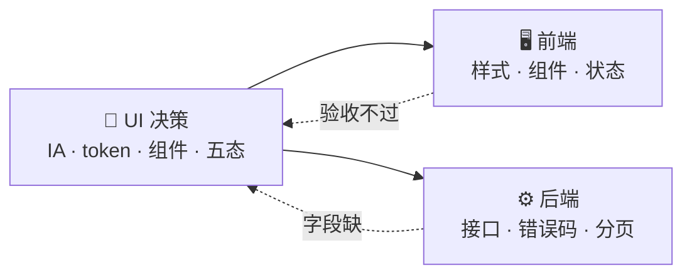

# UI 不是美化，UX 不是画流程

后端看 UI/UX，最容易归成两类：UI 是「把东西弄好看」，UX 是「画页面跳转图」。于是态度就变成「我审美不行，找个设计师或者用现成组件库就行」。

这个态度有两个问题。

**第一，「用现成组件库就行」本身就是个 UI 决策，而且是不可逆决策。** 组件库选错，后面暗色模式、品牌定制、移动端适配全要返工。你以为跳过了 UI 决策，其实是做了一个没经过思考的 UI 决策。

**第二，UI 和 UX 的大部分工作不是审美，是结构。** 信息怎么排、状态怎么设、间距怎么定、断点怎么切——这些全是逻辑。你后端那套结构化思维迁过来，比审美有用得多。

## 一个你一定见过的例子 🔍

后台页面做出来，功能都对，但用起来就是别扭。你以为「不好看」，其实通常是三件事：

| 🤔 你觉得的问题 | 🎯 真正的原因          |
| --------- | ----------------- |
| 页面看着乱     | 信息没有主次，所有东西一样大    |
| 说不上哪里怪    | 间距没有刻度，每个元素都是随手定的 |
| 用起来卡壳     | 状态没设计，加载白屏、出错没提示  |

三件全是结构问题，和审美没关系。


一句话：你不是要当设计师。你要能判断——这个设计决策，前端接得住吗、AI 生成得出来吗、怎么验收。

