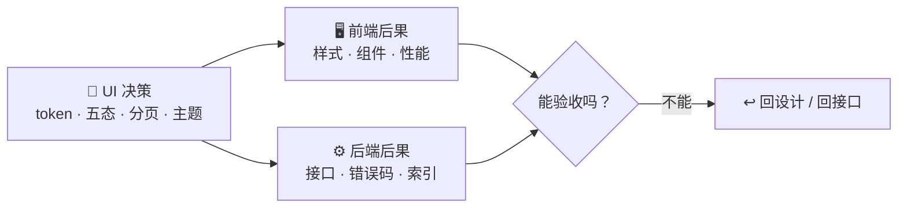

# UI 决策 → 技术后果：映射表

和产品那条线一样，这是这里最值钱的一张表。左边是 UI/UX 常见决策，右边是它给前端和后端埋的坑。评审设计稿、验收 AI 生成的 UI 时，拿这张表逐条过。

| UI 决策      | 前端后果            | 后端 / 架构后果                | 该问什么                  |
| ---------- | --------------- | ------------------------ | --------------------- |
| 没有设计 token | 每个页面写死值、暗色返工    | —                        | 颜色间距有没有变量？            |
| 设计稿只给正常态   | 空 / 加载 / 错误裸奔   | 错误码要分类、空态要能区分            | 五态设计稿在哪？              |
| 无限滚动       | 要虚拟列表 / 性能优化    | 必须游标分页                   | 分页用 offset 还是 cursor？ |
| 表格列多、要排序筛选 | 复杂表格组件          | 查询参数复杂、要索引               | 筛选项对应哪些索引？            |
| 富文本编辑      | 编辑器选型、XSS       | 内容存储格式、清洗                | 存 HTML 还是结构化？怎么防 XSS？ |
| 实时预览 / 协作  | WebSocket / SSE | 长连接、消息广播                 | 用 WS 还是 SSE？断线重连？     |
| 拖拽排序       | 拖拽库、状态同步        | 排序字段设计（order / position） | 排序是整数还是小数 / 链表？       |
| 文件上传（大文件）  | 分片、进度、重试        | 对象存储、分片合并、校验             | 多大文件？断点续传要不要？         |
| 多语言        | i18n 方案、文案膨胀    | 字段多语言存储（JSON / 表）        | 语言存哪？默认语言？            |
| 暗色模式       | token 必须先行      | —                        | token 有没有？后补要多久？      |
| 复杂图表       | 图表库、性能          | 数据聚合、缓存                  | 实时还是预聚合？              |
| 富交互表单（联动）  | 状态管理复杂          | 校验规则要不要共享                | 校验规则前后端怎么共享？          |
| 移动端优先      | 响应式、触控区域        | 接口要不要精简字段                | 移动端字段能砍哪些？            |
| 自定义主题（多客户） | 运行时 token 切换    | 租户表存主题配置                 | 主题配置存哪、怎么下发？          |

## 怎么用 🛠️


设计评审过一遍「前端后果」列，技术方案评审过一遍「后端后果」列。命中的，当场把最后一列的问题问出来。

