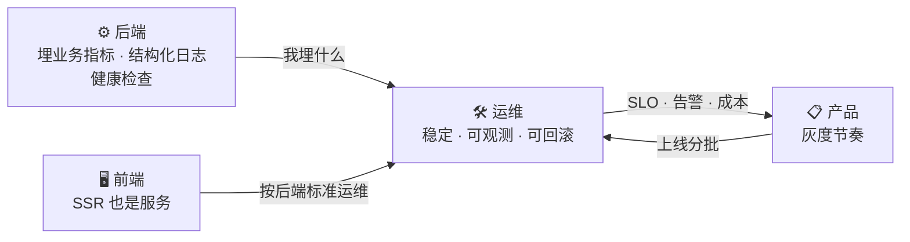

# 运维

后端看运维，最容易归成「部署上线、出问题重启」。于是态度变成：我会 Docker、会敲命令，运维就学到了。

差得远。运维的内核是**稳定性工程**：让服务持续可靠地跑，坏了能快速定位、快速恢复，成本还得可控。

而作为全栈，你比专职运维多一个视角：**你既写代码，又运维它。** 所以你能在写代码那一刻，就把健康检查、业务指标、结构化日志、超时降级、回滚前提顺手做好。这件事纯运维推不动（他们改不了你的代码），纯后端想不到（他们不管线上）。

<table data-view="cards"><thead><tr><th></th><th></th><th></th><th data-hidden data-card-target data-type="content-ref"></th></tr></thead><tbody><tr><td><h3>🧭</h3></td><td><strong>运维不是「把服务跑起来」</strong></td><td>为什么服务突然变慢多半不是代码问题、没有回滚的发布为什么是赌博，以及全栈能多做什么。</td><td><a href="yun-wei-bu-shi-ba-fu-wu-pao-qi-lai.md">yun-wei-bu-shi-ba-fu-wu-pao-qi-lai.md</a></td></tr><tr><td><h3>🏗️</h3></td><td><strong>运维岗的三个层次</strong></td><td>部署与发布、稳定性保障、基础设施与安全。每一层写了「全栈视角为什么必须懂」。</td><td><a href="yun-wei-gang-de-san-ge-ceng-ci.md">yun-wei-gang-de-san-ge-ceng-ci.md</a></td></tr><tr><td><h3>⚖️</h3></td><td><strong>选型维度表：八张表</strong></td><td>部署形态、CI/CD、监控、日志、IaC、密钥、告警、备份灾备。每张带代价和「什么时候该升级」。</td><td><a href="yun-wei-xuan-xing-biao.md">yun-wei-xuan-xing-biao.md</a></td></tr><tr><td><h3>🕳️</h3></td><td><strong>运维决策 → 技术后果：映射表</strong></td><td>15 个运维决策分别给后端、前端、产品埋什么坑，评审时该问什么。</td><td><a href="yun-wei-jue-ce-ji-shu-hou-guo.md">yun-wei-jue-ce-ji-shu-hou-guo.md</a></td></tr><tr><td><h3>🪤</h3></td><td><strong>运维岗的十二个通用坑</strong></td><td>密钥硬编码、发布没回滚、告警疲劳、备份没验证……每条说清表现、后果、怎么防。</td><td><a href="yun-wei-gang-de-shi-er-ge-keng.md">yun-wei-gang-de-shi-er-ge-keng.md</a></td></tr><tr><td><h3>💬</h3></td><td><strong>提问模板：发布、观测、验收</strong></td><td>部署选型、监控告警、发布回滚、备份灾备、安全基线、AI 部署配置验收。</td><td><a href="yun-wei-ti-wen-mu-ban.md">yun-wei-ti-wen-mu-ban.md</a></td></tr></tbody></table>

## 建议读法 🛣️

* **服务要上线了**：先读[运维不是「把服务跑起来」](yun-wei-bu-shi-ba-fu-wu-pao-qi-lai.md)，再对着[十二个坑](yun-wei-gang-de-shi-er-ge-keng.md)自查一遍。
* **要定监控告警**：看[三个层次](yun-wei-gang-de-san-ge-ceng-ci.md)里的稳定性保障，再拿[模板二](yun-wei-ti-wen-mu-ban.md)过一遍。
* **验收 AI 写的 Dockerfile / K8s YAML**：直接用[模板六](yun-wei-ti-wen-mu-ban.md)逐条查。


这条线上最容易吃亏的是\*\*「小团队先简配，但忘了简配了什么」\*\*。托管服务帮你省掉了很多事，但 SLO、业务指标、备份验证这三样，托管也不会替你做。它们恰好是最便宜的——花的是时间，不是钱。

