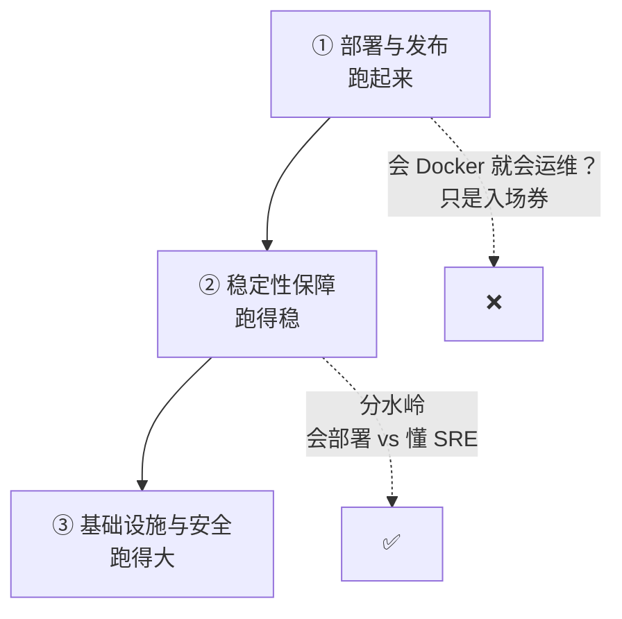

# 运维岗的三个层次

运维的知识分三层。从下往上，能力要求完全不同。大多数人停在第一层，以为那就是全部。

## 第一层：部署与发布（入门）

部署这一层，后端最熟。知识点不复杂，难在细节。

| 知识内核      | 关键点                                                                   |
| --------- | --------------------------------------------------------------------- |
| 🖥️ 环境管理  | 开发 / 测试 / 预发 / 生产，关键是**环境一致性**。容器化就是为它生的                              |
| 🔑 配置与密钥  | 配置与代码分离；密钥不进仓库、不进镜像；配置按环境区分                                           |
| 🚀 发布策略   | 
滚动：一批批换，简单，新旧短暂共存 蓝绿：两套环境切换，回滚快，资源翻倍 金丝雀：先放一小部分流量，最稳也最复杂
 |
| ⏮️ 回滚     | 没有回滚方案的发布等于赌博。回滚要能一键，而且要测过                                            |
| 🗃️ 数据库迁移 | 发布里最危险的一环。迁移必须向前兼容，否则回滚就废了                                            |

### 全栈视角为什么必须懂

* 后端的数据库迁移策略，直接决定这次发布**能不能回滚**
* 前端的 SSR 服务也是要发布的服务，不能当「静态文件」对待
* 产品的上线节奏（灰度、分批），完全依赖发布策略

## 第二层：稳定性保障（SRE 的核心）

这一层是「会部署」和「懂运维」的分水岭。也最容易被跳过。

### 1. SLI / SLO / 错误预算

| 概念   | 是什么         | 例子                    |
| ---- | ----------- | --------------------- |
| SLI  | 你用哪个指标衡量稳定性 | 请求成功率、P99 延迟          |
| SLO  | 你承诺的稳定性水平   | 99.9% 的请求成功           |
| 错误预算 | 1 − SLO     | 99.9% 意味着每月约 43 分钟不可用 |

错误预算用完，就该停止发布新功能，专心修稳定性。


没有 SLO，稳定性就变成了「感觉挺稳的」。出了事靠吵架，扩容靠拍脑袋。**稳定性必须用指标定义，不能靠感觉。**


### 2. 监控三件套

| 工具            | 回答什么      | 关键点                    |
| ------------- | --------- | ---------------------- |
| 📊 指标 Metrics | 系统健康吗     | QPS、延迟、错误率、饱和度（四大黄金指标） |
| 📝 日志 Logs    | 发生了什么     | 结构化、可检索、带 trace\_id    |
| 🧵 链路 Traces  | 请求经过哪、哪步慢 | 跨服务透传 trace\_id        |

关键：**要监控业务指标，不只监控 CPU / 内存。** 订单成功率、支付失败率、注册转化率——这些才是用户感知的「稳不稳」。CPU 才 50%，订单成功率掉了，照样是故障。

### 3. 告警设计

告警疲劳是运维头号杀手：告警太多，最后没人看。

* 可行动：每条告警都对应「该做什么」。答不上来的就是噪音
* 分级：P0 立即、P1 当天、P2 本周、P3 记录
* 收敛：相同根因的告警合并，别刷屏

### 4. 故障响应

* on-call：谁值班、怎么升级、怎么叫醒人
* 升级路径：P0 多久没解决，升级到谁
* 事故复盘：不追责，只追根因和改进项


追责的文化会让所有人隐瞒故障。**blameless postmortem 不是道德要求，是信息质量要求。**


### 全栈视角为什么必须懂

这一层的原料，大部分在后端代码里：

* 业务指标要后端埋
* 日志要后端做成结构化、带 trace\_id
* 健康检查要后端提供（`/health`、`/ready`）
* 告警阈值要后端说清「什么算异常」

运维不会替你埋这些。全栈的人要主动说：我埋什么，你接什么。

## 第三层：基础设施与安全（决定能不能规模化）

| 知识内核     | 关键点                                                       |
| -------- | --------------------------------------------------------- |
| 🏗️ IaC  | 环境用代码定义（Terraform / Pulumi / CloudFormation）。可复现、可版本化、可审查 |
| 🔐 网络与权限 | 最小权限、网络隔离、堡垒机、审计日志                                        |
| 💾 备份与灾备 | 备份不验证恢复，等于没备份。RTO / RPO 要明确                               |
| 🛡️ 安全基线 | 依赖扫描、镜像扫描、密钥轮换、CSP、HTTPS、防 DDoS                           |

### 全栈视角为什么必须懂

* 这一层决定能不能规模化。小团队早期可以简配，但要知道**自己简配了什么、什么时候必须补**
* 安全是不可逆决策：密钥泄露、数据泄露，代价不可逆
* 备份和灾备要后端配合：数据导出、恢复脚本


三层记成一句话：**第一层跑得起来，第二层跑得稳，第三层跑得大。** 只停在第一层，你的运维能力大概只覆盖了一个 demo。

