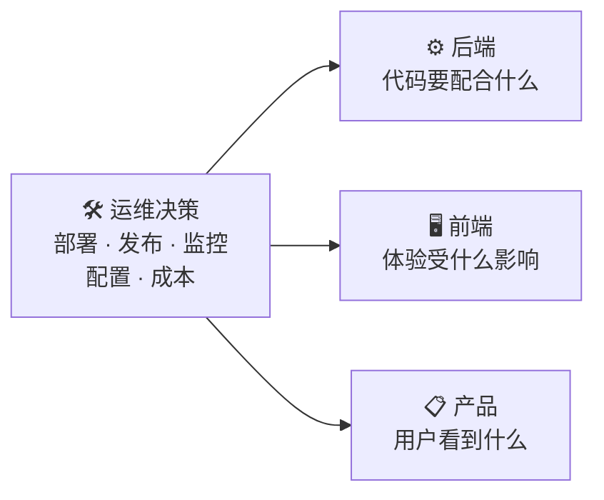

# 运维决策 → 技术后果：映射表

左边是运维的常见决策，右边是它对后端、前端和产品的后果，以及评审时该问什么。

发布评审、架构评审时，把左列过一遍，对着右列问问题。

## 决策映射表 🗺️

| 运维决策            | 后端后果          | 前端 / 产品后果   | 该问什么                    |
| --------------- | ------------- | ----------- | ----------------------- |
| 上 K8s           | 要写健康检查、资源限制   | —           | 服务数够多吗？有专职运维吗？          |
| 无回滚方案           | 数据库迁移要向前兼容    | 发布风险高       | 回滚怎么一键？迁移兼容吗？           |
| 无健康检查           | 编排没法判存活       | 故障时流量还打进来   | 有 `/health` `/ready` 吗？ |
| 无业务指标           | 只能监控 CPU / 内存 | 用户感知的故障发现不了 | 订单成功率、支付失败率埋了吗？         |
| 告警不分级           | 后端被噪音淹没       | —           | 告警分级了吗？可行动吗？            |
| 日志无 trace\_id   | 排查困难          | 用户报错没法追     | 日志带 trace\_id 吗？        |
| 密钥硬编码           | 泄露事故          | —           | 密钥进仓库 / 镜像了吗？           |
| 无备份验证           | 数据丢失不可逆       | 用户数据没了      | 备份恢复演练过吗？RTO / RPO？     |
| 环境不一致           | 「本地是好的」       | 预发测不出问题     | 用容器保证一致了吗？              |
| 无 SLO           | 稳定性靠拍脑袋       | 用户体验无标准     | SLO 定了吗？错误预算多少？         |
| 全量日志存储          | 成本失控          | —           | 日志保留期？采样吗？              |
| Serverless 跑长任务 | 任务被中断         | 功能不可用       | 有长任务吗？超时多久？             |
| SSR 当静态文件       | 前端整站打不开       | 用户白屏        | SSR 有监控、扩容、回滚吗？         |
| 单点部署            | 一次故障全挂        | 用户全量受影响     | 多副本？跨区？RTO / RPO？       |
| 权限不最小化          | 误操作、安全事故      | —           | 谁能上生产？有审计日志吗？           |

## 怎么用这张表 🧰

三种场合：

1. **发布前评审**：把「无回滚方案」「环境不一致」两行先过一遍，这两条最常出事故。
2. **架构评审**：看「上 K8s」「Serverless 跑长任务」「单点部署」，确认部署形态和业务形态匹配。
3. **监控方案评审**：看「无业务指标」「告警不分级」「日志无 trace\_id」，确认可观测三件套齐了。

> 表里每一行都是硬要求：**如果是「没做」，那就不是「以后再补」，而是「这次发布就有风险」。**


这张表的用法不是「查答案」，是**逼出问题**。每一行右侧的问题，只要有一个答不上来，就是一处没想清楚的地方。

