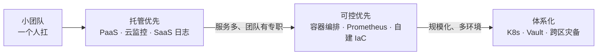

# 选型维度表：八张表

运维选型选的是：部署形态、CI/CD、监控、日志、IaC、密钥管理、告警策略、备份灾备。

每张表都带「代价」和「什么时候该升级」。查表用，别从头推。

## 表一：部署形态 🖥️

| 选项                              | 适合什么      | 代价        | 技术后果                | 什么时候该升级   |
| ------------------------------- | --------- | --------- | ------------------- | --------- |
| PaaS（Vercel / Railway / Render） | 小团队、快速上线  | 被锁定、定制受限  | 几乎零运维               | 成本超了或要定制  |
| 容器 + 托管编排（ECS / Cloud Run）      | 中小团队、要可控  | 要学容器和编排   | 要写 Dockerfile、配健康检查 | 服务多、要精细调度 |
| K8s（自建 / 托管）                    | 服务多、大团队   | 运维成本高、要专职 | 要懂 K8s 生态           | 服务少时别上    |
| Serverless                      | 流量波动、事件驱动 | 冷启动、长任务受限 | 要适配运行时              | 有长任务或常驻连接 |
| 物理机 / VM                        | 特殊需求、成本敏感 | 运维全自己扛    | 要自己管一切              | 基本不推荐小团队  |


**判断心法**：小团队默认 PaaS 或「容器 + 托管编排」，别自建 K8s。什么时候上 K8s？当**服务数量多到手动管不过来、且团队有专职运维**时。服务少上 K8s = 给自己找活干。


## 表二：CI/CD 🔁

| 选项             | 适合什么           | 代价            |
| -------------- | -------------- | ------------- |
| GitHub Actions | 仓库在 GitHub、小团队 | 免费额度；复杂流程要自己写 |
| GitLab CI      | 仓库在 GitLab     | 要维护 Runner    |
| Jenkins        | 复杂定制、老团队       | 维护成本高         |
| 云厂商 CI/CD      | 全家桶用户          | 被锁定           |

**判断心法**：仓库在哪，优先用哪家的 CI。GitHub Actions 对小团队最省心。Jenkins 除非有历史包袱，否则别自建。

## 表三：监控方案 📊

| 选项                          | 适合什么    | 代价       |
| --------------------------- | ------- | -------- |
| 商业 APM（Datadog / New Relic） | 要省心、预算够 | 贵、按量计费   |
| Prometheus + Grafana        | 要可控、开源  | 要自己维护    |
| 云厂商监控                       | 全家桶用户   | 被锁定、功能有限 |
| 轻量方案（Uptime + 日志 SaaS）      | 极小团队    | 功能少      |

**判断心法**：小团队先上「商业 APM 或云厂商监控」省心，规模大了再考虑自建 Prometheus。别一上来自建全套——运维成本比监控本身还高。

## 表四：日志方案 📝

| 选项                      | 适合什么   | 代价        |
| ----------------------- | ------ | --------- |
| 云厂商日志服务                 | 全家桶用户  | 按量计费，量大就贵 |
| ELK / OpenSearch        | 要可控、量大 | 要维护、资源消耗大 |
| 日志 SaaS（Loki / Datadog） | 中小团队   | 按量计费      |
| 只打本地 + 轮转               | 极小团队   | 排查困难      |


关键是**结构化 + 带 trace\_id + 设保留期**。别全量永久存，成本会失控。


## 表五：IaC 🏗️

| 选项                      | 适合什么    | 代价         |
| ----------------------- | ------- | ---------- |
| Terraform               | 多云、通用   | 要学 HCL、管状态 |
| Pulumi                  | 想用编程语言写 | 要学 SDK     |
| 云厂商原生（CloudFormation 等） | 单云      | 被锁定        |
| 手动 + 文档                 | 极小团队、早期 | 不可复现、易漂移   |

**判断心法**：环境超过 2 套、或团队超过 2 人，就该上 IaC。小团队先从 Terraform 起步，单云可以用云厂商原生。

## 表六：密钥管理 🔑

| 选项                             | 适合什么     | 代价       |
| ------------------------------ | -------- | -------- |
| 环境变量                           | 小团队起步    | 容易泄露、轮换难 |
| 云厂商密钥服务（KMS / Secrets Manager） | 生产环境     | 要配置、按量计费 |
| Vault                          | 要强管控、多环境 | 要维护      |
| 硬编码                            | ❌ 永远不行   | 安全事故     |


环境变量起步可以，但**生产环境一律上密钥服务**。硬编码是红线，一次泄露全完，不可逆。


## 表七：告警策略 🔔

| 策略        | 适合什么   | 代价         |
| --------- | ------ | ---------- |
| 全量告警      | ❌ 新手做法 | 告警疲劳，最后没人看 |
| 分级 + 收敛   | 所有团队   | 要设计规则      |
| 只告警 P0    | 极小团队   | 可能漏 P1     |
| SLO 燃烧率告警 | 成熟团队   | 要先把 SLO 定好 |

**判断心法**：告警必须分级 + 可行动 + 收敛。每条告警问一句「收到它我该做什么」，答不上来的删掉。

## 表八：备份与灾备 💾

| 选项      | 适合什么   | 代价         |
| ------- | ------ | ---------- |
| 云厂商自动备份 | 大多数场景  | 按量计费、要验证恢复 |
| 自建备份脚本  | 特殊需求   | 要维护、要演练    |
| 跨区域灾备   | 高可用要求  | 成本翻倍       |
| 不备份     | ❌ 永远不行 | 数据丢失不可逆    |

**判断心法**：备份必须做，且**必须验证恢复**。明确 RTO / RPO，按业务重要性分级。

## 速查图 🧭


八张表其实是一个方向：**先用托管把事跑起来，等规模逼着你自建再自建。** 反过来做，运维成本会吃掉整个团队。

