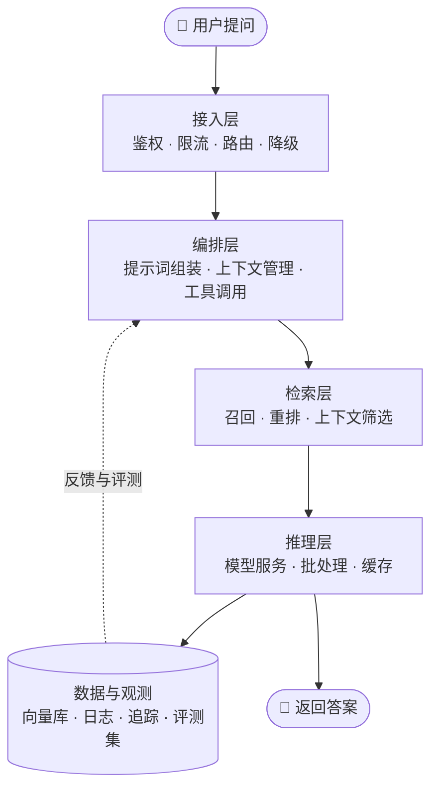

# AI 全栈的能力地图 🗺️

## 一次请求的旅程 🚶

用户按下回车之后，一次请求大概会经过下面这几层：

这五层里，只有推理层属于模型自己的领域。**其余四层，都是标准的后端工程问题**——这也是后端转 AI 最大的底气。

## 五层分别在回答什么 🔍

| 层     | 核心问题                    | 主要由谁负责       | 出问题时的典型症状          |
| ----- | ----------------------- | ------------ | ------------------ |
| 接入层   | 这个请求该不该进来？走哪个模型？失败了怎么办？ | 后端 · 运维      | 被恶意请求打爆、一个慢请求拖垮整页  |
| 编排层   | 这次调用带什么上下文？要不要调工具？      | 后端           | 提示词越改越乱、上下文超长、工具乱调 |
| 检索层   | 哪些资料和当前问题真正相关？          | 后端           | 答非所问、该召回的资料没召回来    |
| 推理层   | 怎么把请求变成 token，再变回文本？    | 算法 · 运维（GPU） | 延迟高、吞吐上不去、显存爆      |
| 数据与观测 | 出了问题怎么定位？改动的效果怎么衡量？     | 后端 · 运维      | 线上出事只能靠猜           |

## 三条贯穿全局的暗线 🧵

不管你在哪一层干活，最后较劲的都是这三件事：

| 暗线    | 具体表现             | 常见手段                 |
| ----- | ---------------- | -------------------- |
| ⏱️ 延迟 | 一次请求是 2 秒还是 20 秒 | 流式输出、缓存、并行召回、超时降级    |
| 💸 成本 | 每千次调用花多少钱        | 模型分级、上下文裁剪、缓存命中、批处理  |
| 🎯 质量 | 答得对不对、稳不稳        | 评测集、badcase 回归、小流量灰度 |

这三条不是分开的：想降延迟常要砍上下文，砍完质量可能掉；想省钱用便宜模型，质量又可能掉。**所谓工程化，就是在三者之间找那个能接受的平衡点。**

## 一个常见的误判 ⚠️


最常见的误判：**把 AI 应用当成「前端 + 一次 API 调用」。**


按这种理解做，团队会跳过编排层和观测层，直接写业务代码。上线后几乎必然撞上三类问题：

1. **延迟不可控**——没有超时和降级，一个慢请求就能拖垮整个页面
2. **成本不可见**——不知道钱花在哪，想优化也无从下手
3. **效果无法回归**——改了提示词，没人说得清是变好还是变坏

本书后面的内容，本质上都在补这三个洞。

## 这套地图和岗位的关系 👥

第二部分按岗位展开，你可以先在这里对号入座：

* 🧠 **产品**：决定要做到什么程度。这些决定最后都会变成技术约束
* 🎨 **UI**：决定正常态之外的那几种状态长什么样（空、加载、错误、边界）
* 🖥️ **前端**：负责用户能直接感知的部分——流式渲染、中断、重试
* ⚙️ **后端**：主战场在接入层、编排层、检索层
* 🛠️ **运维**：推理部署、GPU 资源、观测与告警

## 自测：你的能力缺口在哪 🔍

* [ ] 能说清一次请求经过哪几层
* [ ] 知道自己项目里的延迟主要花在哪一层
* [ ] 能估算一次调用的成本量级
* [ ] 有一套可重复跑的评测集
* [ ] 线上出问题时，能在 10 分钟内定位到是哪一层的问题

勾不满很正常，这本书就是来补这些的。

## 记住三句话 💡

1. 五层里只有推理层是模型自己的领域，其余四层都是后端工程问题
2. 工具一直在换，分层基本不变——先记分层，再记工具
3. 先能定位问题在哪一层，再谈优化
